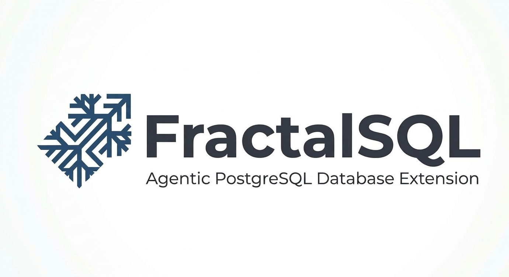

<p align="center">
  
</p>

# Docker Demo: The Learning Path

Try FractalSQL without installing anything. `docker-compose.yml` at the repo root
builds a Postgres 18 image with the extension pre-installed and stands up a
turnkey demo environment.

## 🛠️ Prerequisites

Docker and Docker Compose. The demo builds the extension from source inside the
container, so no local PostgreSQL installation or compiler is required.

---

## 🚀 Setup Guide

### 1. The turnkey default — `docker compose up -d`

One command, no flags, gives you the bare minimum:

- **Postgres 18** running, DB `fractalsql_demo`, with **both** `fractalsql` and
  `fractalsql_agents` enabled (the base extension + the sixteen agents; 15
  run on Community, `fractal_agent_diverse_portfolios` needs the enterprise
  library, see [Enterprise Tier](enterprise.md)).
- **Ollama** running with **no model pulled** (model download is opt-in, step 2).
- Every demo + the `bench/` head-to-head benchmarks inside the container (`/demo/`,
  `/bench/`). Demos are **demoable on demand**: they are not run at init, because
  reasoning is inert until a model is pulled and the demos are re-runnable.

```bash
docker compose up -d
```

**Quick test** (works with no model; base Sniper search needs no LLM):
```bash
docker compose exec postgres psql -U postgres -d fractalsql_demo -c \
  "SELECT fractal_search(ARRAY[0.6, 0.8, 0.0]::float8[], iterations => 100);"
```

Confirm both extensions loaded:
```bash
docker compose exec postgres psql -U postgres -d fractalsql_demo -c "\dx"
# expect: fractalsql, fractalsql_agents
```

Run any demo (re-runnable; each recreates its own fixture tables):
```bash
docker compose exec postgres psql -U postgres -d fractalsql_demo -f /demo/<demo>.sql
```

Or run every demo in `demo/` in one pass with the `run_demo.sh` runner.
From the repo root — or inside the container, matching the invocation
style above — both shapes work:
```bash
./demo/run_demo.sh
# ...or the in-container form:
docker compose exec postgres /demo/run_demo.sh
```
It feeds each `/demo/*.sql` through `psql -v ON_ERROR_STOP=1` against the
demo database (DB `fractalsql_demo`, user `postgres` — the compose demo
service's own `POSTGRES_*` env), logs per file to
`/tmp/fractalsql_demo_run/`, applies a per-file timeout (default 300s,
overridable via `FSQL_DEMO_RUN_TIMEOUT`), and prints a final
`N ok, M non-zero exit` tally. A non-zero exit from one file is a "go
read its log" signal, not proof of a bug — on this PostgreSQL column the
most common one is the no-model-yet error a reasoning-dependent demo hits
until step 2 is done (pull a model, then re-run it); the demos' deliberate
error demonstrations (CHECK/dimension/metric rejections) are all caught in
`DO ... EXCEPTION` blocks, so they complete clean under `ON_ERROR_STOP=1`,
and the enterprise-tier demos exit successfully with the documented
dormant-path NOTICE. `run_demo.sh --help` lists the flags
(`--quiet`/`--only`/`--skip`) plus `--include-response-modes` for
`response-modes.sql`, which is skipped by default — see
[Response modes](../demo/README.md#response-modes) for why it needs
separate treatment. On this image you should see extension version
**2.0.20**.

**Alternative: Docker Model Runner (Docker Desktop only).** Skip the
`ollama` container and use Docker Desktop's built-in Model Runner instead:

```bash
docker model pull ai/gpt-oss:20b
docker model pull ai/nomic-embed-text-v1.5
docker compose -f docker-compose.yml -f docker-compose.dmr.yml up -d postgres
```

`docker-compose.dmr.yml` repoints the postgres container's reasoning GUC
defaults (`fractalsql.http_url`/`fractalsql.http_model` for chat,
`fractalsql.http_embed_url`/`fractalsql.http_embed_model` for embeddings) at
`model-runner.docker.internal` — nothing else changes. Name the services on
the `up` (`postgres`, plus `mcp` if you also want the MCP demoable) so the
bundled `ollama` container doesn't start at all. Everything else in this
guide — the demo commands, `run_demo.sh`, the MCP one-liners — works the
same either way. Requires Docker Desktop 4.41+ with Model Runner enabled
(Settings → Beta features, or `docker desktop enable model-runner`); see
[reasoning-setup.md](reasoning-setup.md#docker-model-runner-dmr).

### 2. Cognition — pull a model (opt-in)

Reasoning (`fractal_reason`, `fractal_embed`, `fractal_text_to_sql`) needs a model.
Ollama is already up from step 1; pull one with the `pull-model` one-shot:
```bash
docker compose --profile pull-model run --rm pull-model
```
…or, equivalently, `docker compose exec ollama ollama pull gpt-oss:20b` (and
`nomic-embed-text`). This pulls ~13.8GB (gpt-oss:20b) + a few hundred MB
(nomic-embed-text). CPU-only inference may take several minutes per query on
modest hardware. See [docs/reasoning-setup.md](reasoning-setup.md)'s hardware
section. (Or point `fractalsql.http_url` at a cloud endpoint instead; see
[Reasoning Setup](reasoning-setup.md).)

**Quick test** (now that a model is present):
```bash
docker compose exec postgres psql -U postgres -d fractalsql_demo -c \
  "SELECT fractal_reason('summarize this', '{\"note\": \"hello from the demo\"}');"
```

Re-run any cognition demo now for full reasoning output: e.g. the sixteen-agent
validation:
```bash
docker compose exec postgres psql -U postgres -d fractalsql_demo -f /demo/demo-agents.sql
```

### 3. Vectorizer automation

No extra containers: reuse the model from step 2. Enables automatic embedding
pipelines:
```bash
docker compose exec postgres psql -U postgres -d fractalsql_demo -f /demo/demo-vectorizer.sql
```

---

## 🔌 Try the MCP server

One of the demoables is the same thing a real MCP client talks to — the
FractalSQL MCP plugin, built from `mcp/` **in-container on the service's
first start** (gcc image + `make`, per the plugin's plain-Makefile build
standard; see [docs/mcp-plugin.md](mcp-plugin.md) for
the full tool catalog and client config). The demo's `mcp` service reuses
the demo database and credentials and exposes exactly four pinned tools —
`fractal_search`, `fractal_reason`, `fractal_agent_data_analyst`, and
`fractal_agent_diverse_portfolios` (the last one deliberately so you can see
a real enterprise-tier call's clean "enterprise tier not loaded" behavior on
this Community-only install). The same binary speaks stdio (the
desktop-client shape) inside the container — a zero-dependency one-liner
pumps JSON-RPC into it:

```bash
# Discovery (no LLM required) -- the one-liner (spec 9.2):
docker compose exec mcp /demo/mcp/call-tool.sh fractal_search '{"query":[0.6,0.8,0.0]}'

# The horizontal catch-all agent (an LLM-reasoned answer over real demo data).
# Needs a reasoning model configured first -- run step 2 "Cognition" of the
# setup guide above or this surfaces the clean "reasoning not configured"
# error instead (the engine's own error, verbatim).
docker compose exec mcp /demo/mcp/call-tool.sh fractal_agent_data_analyst \
  '{"question":"Which services have warning or critical severity alerts?","table_names":["demo_alerts"]}'
```

The Discovery result comes back as an MCP tool result (a plain JSON array of
numbers — the converged best point). `fractal_agent_diverse_portfolios` (the
tool is pinned in the demo's whitelist, not shown above) returns the clean
enterprise-tier error on this Community-only install. Want a real, richer
client against this same database? The optional interactive inspector needs
Node on your *host* only — nothing in the demo:

```bash
npx @modelcontextprotocol/inspector docker compose exec mcp /demo/mcp/call-tool.sh
```

The `mcp` service also runs the authenticated HTTP transport on
`http://localhost:18765/mcp` (Bearer token `fractalsql-demo-token`, set via
`FSQL_MCP_AUTH_TOKEN` in compose) for pointing an actual MCP client at the
demo database — see the plugin doc's client config. NOTE on credentials: the
demo connects with the compose project's own superuser — fine for a throwaway
demo, never the posture for the real plugin (see the plugin doc's
least-privilege section).

---

## 🎓 The Learning Path

Run the demos in this order to see the progression from a vector search tool to a
sovereign agentic database. (Cognition/Agency demos need a model from step 2;
Discovery demos do not.)

### Level 1: Geometric Discovery
*Focus: Using the fractal core and domain-specific geometry to find structure in noise.*
- **Goal**: Learn to use SFS for high-precision convergence and domain-specific metrics (vascular, cortical, nerve).
- **Demos**:
  ```bash
  # MedTech: Clinical Telemetry & Patient Monitoring
  docker compose exec postgres psql -U postgres -d fractalsql_demo -f /demo/demo-vertical-medtech-clinical.sql
  # Maritime: AIS & Radar Tracking
  docker compose exec postgres psql -U postgres -d fractalsql_demo -f /demo/demo-vertical-maritime-defense.sql
  # Fleet: Last-Mile Delivery
  docker compose exec postgres psql -U postgres -d fractalsql_demo -f /demo/demo-vertical-fleet-logistics.sql
  # Smart Cities: IoT Sensor Grids
  docker compose exec postgres psql -U postgres -d fractalsql_demo -f /demo/demo-vertical-smart-cities-iot.sql
  ```

### Level 2: Cognitive Synthesis
*Focus: Composing search with LLM reasoning to generate human-readable insights.*
- **Goal**: Learn to feed Scout Discovery results into `fractal_reason` and use `fractal_text_to_sql` for safe data exploration.
- **Demos**:
  ```bash
  # Recommendations: Advanced Discovery Engines
  docker compose exec postgres psql -U postgres -d fractalsql_demo -f /demo/demo-vertical-recommendation-search.sql
  # Sovereign: Edge & Autonomous Systems AI
  docker compose exec postgres psql -U postgres -d fractalsql_demo -f /demo/demo-vertical-sovereign-edge-ai.sql
  # BI: The Full Reasoning Loop (Question -> SQL -> Result -> Reason)
  docker compose exec postgres psql -U postgres -d fractalsql_demo -f /demo/demo-business-intelligence.sql
  ```

### Level 3: Autonomous Agency
*Focus: Building self-correcting, safe, and predictive agentic workflows.*
- **Goal**: Learn to use loop detection (SimHash fingerprints + cycle detection), trajectory prediction, and self-correcting SQL agents. The reference blueprint agents ship inline in each vertical demo; the sixteen installable agents are exercised by `demo-agents.sql` (which uses the real `CREATE EXTENSION fractalsql_agents` product path).
- **Demos**:
  ```bash
  # DevOps: Autonomous Incident Triage & Self-Healing
  docker compose exec postgres psql -U postgres -d fractalsql_demo -f /demo/demo-vertical-agentic-ops-devops.sql
  # Support: Stateful Session & Churn Drift
  docker compose exec postgres psql -U postgres -d fractalsql_demo -f /demo/demo-vertical-agentic-customer-support.sql
  # FinTech: MCTS Scenario Exploration & Safe Execution
  docker compose exec postgres psql -U postgres -d fractalsql_demo -f /demo/demo-vertical-agentic-fintech-mcts.sql
  # Cyber: Threat Detection & Triage
  docker compose exec postgres psql -U postgres -d fractalsql_demo -f /demo/demo-vertical-cybersecurity-threat-detection.sql
  # Edge Swarm: quantized swarm memory, loop detection, task routing (no reasoning needed)
  docker compose exec postgres psql -U postgres -d fractalsql_demo -f /demo/demo-vertical-agentic-edge-swarm.sql
  # The sixteen installable agents (requires fractalsql_agents, already enabled)
  docker compose exec postgres psql -U postgres -d fractalsql_demo -f /demo/demo-agents.sql
  ```

See [Agent Recipes](api-agency.md#which-agent-should-i-use) for what each agent
does and when to use it.

### Other demos in the image

`/demo/` also contains `demo.sql` (the base walkthrough), `response-modes.sql`,
`demo-text-to-sql.sql`, the `text-to-sql-spike-*.sql` series, `demo-fractal-vector.sql`,
`demo-vertical-biotech-genomics.sql` (TDA + L_p on a cyclic peptide and
single-cell expression profiles, no reasoning needed),
`benchmark.sql`, and `benchmark-api-reference.sql`, plus the enterprise-tier
`enterprise-qtl-audit.sql` / `enterprise-stress.sql` (both run cleanly on
this Community-only install and tell you which tier they found). Run any of
them the same way. `demo/demo-workload.sh` (the sustained concurrent-load
tester — simulated users issuing a realistic mix of calls for a fixed wall
time) is also in the image at `/demo/`; it is a bash script, not SQL, so run
it with `docker compose exec postgres /demo/demo-workload.sh --help`.

---

## 📊 Validation & Benchmarks

### Scout vs. HNSW (in-database demo)
See how Scout Discovery captures more distinct clusters than standard top-K search.
This uses FractalSQL's own `fractal_vector` type. No pgvector needed:
```bash
docker compose exec postgres psql -U postgres -d fractalsql_demo -f /demo/benchmark.sql
```

### Full API surface
Exercise all 40+ functions (Search, Reason, Agents, Analytics) in one pass:
```bash
docker compose exec postgres psql -U postgres -d fractalsql_demo -f /demo/benchmark-api-reference.sql
```

### Head-to-head benchmark vs. pgvector (optional)
`bench/` runs the real HNSW-vs-Scout head-to-head from `bench/README.md`. pgvector is
**optional** because only this benchmark needs it; the demos don't. Its Python deps
are pre-installed in `/bench/.venv`. Enable pgvector and stand up the benchmark DB
with the `pgvector` profile (creates `fractalsql_bench` with both `vector` and
`fractalsql` extensions):
```bash
docker compose --profile pgvector up -d pgvector-init
```
Then run the bench in-container:
```bash
docker compose exec postgres /bench/.venv/bin/python3 /bench/data_gen.py --dsn 'dbname=fractalsql_bench user=postgres'
docker compose exec postgres /bench/.venv/bin/python3 /bench/head_to_head.py --dsn 'dbname=fractalsql_bench user=postgres'
```
…or run it from the host against `localhost:15432` with your own Python env
(`pip install -r bench/requirements.txt`). See `bench/README.md` for the output
shape and tuning knobs.

---

## 🧹 Cleanup

```bash
docker compose down -v                       # default services + volumes
docker compose --profile pull-model down -v  # also remove the pulled-model volume
docker compose --profile pgvector down -v    # also remove the bench DB volume
```

The `-v` flag removes the named volumes (Postgres data, the Ollama model cache).
Drop it if you want to keep them for next time.