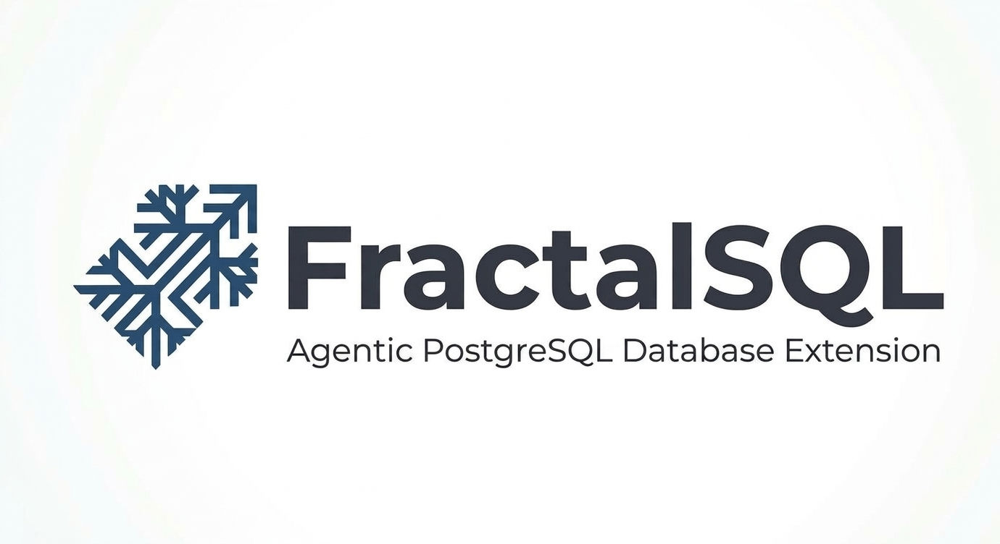

<p align="center">
  
</p>

# FractalSQL MCP Plugin — PostgreSQL

A Model Context Protocol server for FractalSQL's PostgreSQL extension: **one
tool per SQL function**, spoken over standard MCP, so any external agent or
MCP client — Claude Desktop, Cursor, Windsurf, Claude Code, LangChain,
LlamaIndex, CrewAI, the Vercel AI SDK, an IDE, an enterprise workflow — can
call a FractalSQL primitive or recipe and get back a finished, reasoned result
without writing a line of SQL.

The server is a **standalone C++17 binary** (`mcp/` in this repo — plain
`make` on Linux/macOS, MSVC + vcpkg OpenSSL on Windows, exactly the repo's
existing build story). It links libpq directly: every argument reaches SQL
as a `$n`-bound parameter, never string-built SQL.

**Why this exists.** FractalSQL's in-database agents are the *micro*
orchestration tier: tight, fast Retrieve → Reason → Act → Guard loops running
entirely inside the database process. This MCP server is the *macro*
orchestration bridge: it lets an external agent call one clean tool per
capability without ever learning PL/pgSQL's set-returning-function
conventions. You point it at a database that already has both extensions
installed (`fractalsql` + `fractalsql_agents`; see
[getting-started.md](getting-started.md) — it never creates or changes them
itself, it is a caller, not an installer) and register it in your MCP client.

Clients that support manifest-based discovery can
read this server's generated `manifest.json` instead of running the binary
first.

## Deployment topologies

The server itself only ever does two things: connect to one PostgreSQL
database under the ordinary libpq env/conninfo surface, and speak JSON-RPC
over stdio or HTTP. Everything below is what you put on either side of it; none of
it requires a code change in this repo, and any database posture combines with
any reasoning posture.

- **Local-first / air-gapped.** stdio transport, a local PostgreSQL
  instance, and a local reasoning backend (Ollama, or any OpenAI-compatible
  server on localhost) for zero network egress end to end. This is the
  posture [docker-demo.md](docker-demo.md) runs. It's also the relevant shape
  for constrained edge hardware, not just workstations: the server is a plain
  C++17 binary with no interpreter or `node_modules` tree to provision, so
  the footprint is the binary, the libpq/OpenSSL libraries it links, a
  `PG*` env pointing at the database, and whatever model runtime you pair
  it with.
- **Enterprise cloud reasoning.** Point the engine's reasoning config at a
  managed LLM account instead of a local model: AWS Bedrock, Azure OpenAI,
  GCP Vertex AI, or an OpenAI-compatible serving layer (vLLM, Together AI,
  Fireworks AI). This is engine-level configuration, not MCP-specific: set
  it exactly where the engine's docs put it, through this engine's
  `fractalsql.http_url` / `fractalsql.http_model` /
  `fractalsql.http_embed_url` GUCs — via the
  `fractal_configure_reasoning` admin tool (`ALTER SYSTEM SET` +
  `pg_reload_conf()`; see [reasoning-setup.md](reasoning-setup.md)) or an
  operator-side `ALTER SYSTEM SET`. The MCP layer never stores a provider
  token itself.
- **Containerized / sidecar.** The binary drops into a Docker/Kubernetes
  sidecar next to the PostgreSQL cluster — no interpreter or package
  manager in the image. The repo's own [docker-compose.yml](../docker-compose.yml)
  `mcp` service is this shape, and [docker-demo.md](docker-demo.md) is its
  walkthrough.
- **Network-exposed HTTP transport.** Two ways to get TLS on the wire, pick
  one: put a reverse proxy/LB in front (the zero-config default — bind the
  binary to `127.0.0.1` via `FSQL_MCP_HTTP_HOST` and let the proxy own TLS)
  or run `--https` so this process terminates TLS itself (no proxy to
  deploy, at the cost of this binary now holding the cert/key). Either way
  the Bearer-token check is the same; see
  [Security & supply chain](#security--supply-chain).

---

## Quickstart

### 1. Configuration (environment variables, spec 1.2)

The database connection is the ordinary libpq surface — all standard:

| Variable | Purpose |
| --- | --- |
| `PGHOST` / `PGPORT` / `PGDATABASE` / `PGUSER` / `PGPASSWORD` | Standard libpq connection env (or a full conninfo string via `FSQL_MCP_PG_CONN_URI`). |
| `FSQL_MCP_ENABLED_CATEGORIES` | Serve only these categories (comma list of `discovery,cognition,agency,analytics,enterprise,vectorizer,admin`) — unset means all. |
| `FSQL_MCP_TOOL_WHITELIST` | Serve only these named tools (also `--tool a,b,c` / `--category x,y` on the command line). |
| `FSQL_MCP_READ_ONLY` | `true` = deployment-wide kill switch: every `destructiveHint` tool is refused before reaching the engine. It keys on `destructiveHint`, not on `readOnlyHint` — every tool marked destructive, not every write. |
| `FSQL_MCP_MAX_ROWS_CEILING` | Hard row ceiling on array results — default 1000; a caller's `limit` can never exceed it. |
| `FSQL_MCP_MAX_CONCURRENT_CHEAP` | Cheap-tier (Discovery/Analytics/Vectorizer/Admin) concurrency cap — default 50. Every `FSQL_MCP_MAX_CONCURRENT_*` and `FSQL_MCP_MAX_QUEUE_WAIT_MS` must be a whole number of at least 1; anything else, including 0, makes the server refuse to start instead of hanging every call. |
| `FSQL_MCP_MAX_CONCURRENT_EXPENSIVE` | Expensive-tier (anything dispatching a real LLM call) cap — default 5. |
| `FSQL_MCP_MAX_CONCURRENT_EXPENSIVE_PER_CLIENT` | Per-client expensive cap on shared deployments — default 2. |
| `FSQL_MCP_MAX_QUEUE_WAIT_MS` | Bounded wait for a concurrency slot before a `server busy` error — default 900000. |
| `FSQL_MCP_TRANSPORT` | `stdio` (default) or `http` (shared, multi-client; also `--http PORT`). |
| `FSQL_MCP_HTTP_PORT` | HTTP transport port — default 8765 (path `/mcp`, overridable via `FSQL_MCP_HTTP_PATH`). |
| `FSQL_MCP_HTTP_HOST` (also `--host H`) | HTTP transport bind address — default **`127.0.0.1` (loopback only)**. The all-interfaces bind is opt-in and explicit: `FSQL_MCP_HTTP_HOST=0.0.0.0` or `--host 0.0.0.0` (what a published Docker port assumes — `docker-compose.yml`'s `mcp` service sets it). **Security note:** the server exposes SQL execution behind a bearer token, so the default stays off the network; widen the bind only when something in front of it (a reverse proxy, a container port publish) needs the socket. A value that does not parse is a startup error, never a silent fallback. |
| `FSQL_MCP_AUTH_TOKEN` / `FSQL_MCP_AUTH_TOKEN_FILE` | HTTP-transport Bearer token (opaque; stdio needs no auth). The file form hot-reloads on rotation; SIGHUP forces the reload. |
| `FSQL_MCP_EXPECT_VERSION` | Version-skew guard — warns when the engine's `fractal_version()` differs (default: this binary's own version). |
| `FSQL_MCP_AGENT_PARTIAL` | `false` = don't turn the engine's `agent_partial_reasoning_fail` on for this server's sessions. Default `true`: every session issues `SET fractalsql.agent_partial_reasoning_fail = on`, so a domain agent whose LLM step fails returns its computed data half instead of a hard raise -- the thirteen PL/pgSQL agents report it as a `null` LLM field plus a separate `reasoning_step_failed` field, the C-native ones as a `reasoning_step_failed:` answer string (see [api-agency.md](api-agency.md)). A warning is logged if the session couldn't set it (e.g. an engine predating the key). |
| `FSQL_MCP_LOG_LEVEL` | `normal` (default: no argument bodies), `verbose` (size-capped, redacted bodies on the JSON log lines to stderr), or `error` (tool-call lines suppressed; only errors logged). |
| `FSQL_MCP_SHUTDOWN_DRAIN_MS` | Graceful-shutdown drain window — default 5000. |
| `FSQL_MCP_STRICT_SCHEMA_HASH` | A tool-schema hash mismatch is a startup failure by default; set `false` to downgrade it to a warning. (The safety-annotation lock at `mcp/.mcp-safety-annotations-lock` is *always* hard.) |
| `FSQL_MCP_MAX_CONNECTIONS` | Most HTTP connections served at once (default 256, never more than half the process's file-descriptor limit). A connection past the limit is answered `503` and closed. |

Requests whose JSON nests deeper than 128 levels are rejected with a parse error, and an HTTP request with ambiguous framing (a repeated or non-numeric `Content-Length`, or an unsupported `Transfer-Encoding`) is refused with `400`.

FractalSQL's own reasoning/enterprise configuration is **not** duplicated
here: it lives in the `fractalsql.*` GUCs as
[reasoning-setup.md](reasoning-setup.md) and [enterprise.md](enterprise.md)
already document. The admin tool `fractal_configure_reasoning` wraps the
*provider* GUCs via `ALTER SYSTEM SET` + `pg_reload_conf()` and always
answers "queued; takes effect on the next backend/session" — never "applied".

### 2. Register it in an MCP client

Build it once (`cd mcp && make`), then register it with your MCP client.
Claude Desktop reads `claude_desktop_config.json` and Cursor reads `mcp.json`;
both take the same `mcpServers` shape:

```json
{
  "mcpServers": {
    "fractalsql-postgresql": {
      "command": "/opt/fractalsql/mcp/fractalsql-postgresql-mcp",
      "env": {
        "PGHOST": "127.0.0.1",
        "PGPORT": "5432",
        "PGDATABASE": "mydb",
        "PGUSER": "fsql_mcp_role"
      }
    }
  }
}
```

**Other clients and frameworks.** Windsurf and Claude Code consume the
identical `mcpServers`-shaped config above unmodified, as does any other MCP
client that takes one. Frameworks that don't speak MCP's wire format natively
go through their own MCP client/adapter instead of anything bespoke here:
LangChain (`langchain-mcp-adapters`), LlamaIndex (`llama-index-tools-mcp`),
CrewAI (`MCPServerAdapter` in `crewai-tools`), and the Vercel AI SDK
(`experimental_createMCPClient`) each point their adapter at this same
binary/command the way they'd point at any other MCP server. Those adapters
are third-party and not maintained by this repo; what this project guarantees
is the standard MCP protocol surface, not any particular framework's wrapper
around it.

For a **shared team deployment** (one long-running server, many clients),
set `FSQL_MCP_TRANSPORT=http` and `FSQL_MCP_AUTH_TOKEN=...` and point clients
at `http://host:8765/mcp` as a *remote* server. TLS is **off by default**;
for an exposed (non-localhost) deployment, either posture is fine:
- **Direct TLS from the binary** — run it with `--https 8765 --tls-cert
  cert.pem --tls-key key.pem` (env equivalents: `FSQL_MCP_HTTPS` +
  `FSQL_MCP_TLS_CERT_FILE` / `FSQL_MCP_TLS_KEY_FILE`), and point clients at
  `https://host:8765/mcp`. It fails closed: a cert/key that is missing or
  whose key does not match the cert aborts startup with a non-zero exit.
- **A reverse proxy in front** — keep the binary on plain HTTP bound to
  localhost (the default: `FSQL_MCP_HTTP_HOST=127.0.0.1`) and let the proxy
  own TLS (the posture `docker-compose.yml`'s `mcp` service comment
  describes).

The one rule in both postures: don't expose the plaintext port beyond
localhost, and only `/healthz` and `/readyz` are reachable without the
bearer token. Rotation of the file-form token happens without downtime; the
env-form token changes on restart.

Manifest-based discovery: if your client supports it (Claude Desktop/VS Code
one-click installers), point it at the server's generated
`mcp/manifest.json` — it lists the server's entry point, version and tool
catalog without running the binary first.

### 3. The one-line sanity check

Ask the server for `fractal_version` and expect a real version +
edition back:

```
> use the fractal_version tool
→ {"version": "2.0.22", "edition": "Community"}
```

A Community edition string with enterprise-tier tools returning
`enterprise tier not loaded` is **correct behavior**, not a bug.

---

## Tool catalog

Every tool name **is** the underlying SQL function name, unprefixed; its
arguments mirror that function's documented signature 1:1 (defaults shown are
the SQL defaults; vector arguments are always JSON arrays of numbers — the
server converts to the engine's native form, and back). Tools whose result is
a row set also take `limit` (default 100, hard ceiling
`FSQL_MCP_MAX_ROWS_CEILING`) and return `{rows, truncated, total_scanned}`.
82 tools in all: 14 discovery + 4 cognition + 22 agency + 23 analytics +
10 enterprise + 5 vectorizer + 4 admin. Errors are returned **verbatim, with a
structured `error_class`** — exactly one of `schema`, `engine`,
`connectivity`, `cancelled` or `server` — so a calling agent can branch
programmatically. (`server` is the wire spelling of an internal adapter error:
its client-facing message is a fixed generic string, and the real detail goes
only to the server's stderr log.)

### Discovery (docs/api-discovery.md)

| Tool | Purpose |
| --- | --- |
| `fractal_search` | Sniper-mode SFS convergence to the single best point minimizing cosine distance to a query. |
| `fractal_search_debug` | Same convergence with a full trajectory trace (best fits per generation, particle paths). |
| `fractal_search_explore` | Scout-mode diverse re-ranked population search over an embedding column — the anti-"mode-collapse" primitive. |
| `fractal_search_telemetry` | Ground-truth K nearest real table rows; `doc_id` is the row's ctid (a real locator), `scan_pos` this call's handle. |
| `fractal_hybrid_clinical_search` | Same, restricted to an explicit cohort of row-locator strings (e.g. ctids from ordinary SQL). |
| `fractal_search_trajectory` | Drift-vector search: nearest rows to (current − baseline). `doc_id` here is a scan position, NOT a locator. |
| `fractal_cross_modal_search` | Weighted concatenation of two modality vectors before the search, alpha-weighted. |
| `fractal_diversify_enable` / `_disable` | Turn the stateful Diversify/Repulsion layer on/off for this server session. |
| `fractal_diversify_set_params` | Tune the repulsion layer (window_n, stall_threshold, repulsion_sigma/weight, shadow caps). |
| `fractal_detect_collapse` | Current diversity quotient (D_q) for this session; null when not yet available. |
| `fractal_explain_result` | Session Diversify diagnostics `{dq, diversify_enabled, overhead_p99_us}`. |
| `fractal_feedback_report` / `fractal_isolate_background` | Report dwell/positive/negative engagement by `scan_pos`, feeding the shadow store. |

Worked example (Discovery needs no LLM, works on a default install):

```json
{ "name": "fractal_search_telemetry",
  "arguments": { "table_name": "patients", "vector_col": "vitals_emb",
                 "query": [0.4, 0.1, 0.2], "k": 3 } }
→ { "rows": [ { "doc_id": "(0,2)", "distance": 0.031, "scan_pos": 0 }, ... ],
    "truncated": false, "total_scanned": 3 }
```

Resolve a ctid the ordinary SQL way when you need the row's other columns
(`WHERE ctid::text = doc_id`) — the MCP layer passes the primitive's own
semantics through, never inventing a resolution step.

### Cognition (docs/api-cognition.md)

| Tool | Purpose |
| --- | --- |
| `fractal_reason` | One clean LLM turn: dispatches a query + JSON context to the configured provider and returns the reply. |
| `fractal_embed` | Text → embedding vector (returned as a JSON array of numbers, whatever the engine's native form). |
| `fractal_text_to_sql` | NL question → ONE validated SQL statement, never executed (GENERATE → ALLOWLIST → EXPLAIN pipeline). |
| `fractal_schema_context` | The plain-text schema description the LLM itself sees — call it to audit exactly what a reasoning call will read. |

Worked example:

```json
{ "name": "fractal_text_to_sql",
  "arguments": { "question": "How many orders does customer 'acme' have?",
                 "table_names": ["orders", "customers"] } }
```

Cognition tools need reasoning configured first
([reasoning-setup.md](reasoning-setup.md)): confirm with a
`fractal_reason` confirmation-phrase call before running agents.

### Agency — the sixteen installable agents (docs/api-agency.md)

Note on reasoning failures: this server sets
`fractalsql.agent_partial_reasoning_fail = on` on every session (opt-out via
`FSQL_MCP_AGENT_PARTIAL=false`), so a cognition agent whose LLM step fails
still returns — its computed data half untouched and `isError:false`. How the
failure is reported depends on which agent you called:

- The **thirteen PL/pgSQL agents** (`fractal_agent_anomaly_triage`,
  `fractal_agent_allocate`, …) return their LLM column (`triage_summary`,
  `rationale`, `reason`, `analysis`) as `null` and carry the error text in a
  separate **`reasoning_step_failed`** field. Treat a `null` LLM field plus a
  non-null `reasoning_step_failed` as "the numeric half is real, the LLM half
  is not".
- The **C-native agents** (`fractal_search_agent`, `fractal_rag_agent`) carry
  the marker string `reasoning_step_failed: …` in their `answer` column
  instead (their `source_doc_ids` stay intact).

A full raise means something *before* the reasoning step failed (embed,
search, bad table) — those always raise. A missing reasoning plugin is a
setup mistake and always raises too, flag or no flag.

Thirteen end in a `fractal_reason` step (need reasoning configured):


| Tool | Recipe |
| --- | --- |
| `fractal_agent_anomaly_triage` | Drift exponent on one entity's table-backed metric series → LLM triage. |
| `fractal_agent_regime_triage` | DFA + drift over a single array-in series (no table) → LLM triage. |
| `fractal_agent_track_anomaly` | Trajectory deviation vs. fleet + heading-series DFA → LLM triage. |
| `fractal_agent_detour_classify` | Trajectory deviation + GPS-trace box-counting complexity → LLM classify. |
| `fractal_agent_network_coverage_alert` | Spatial morphology + telemetry drift → LLM alert. (`point_cloud` empirically needs ~≥256 points.) |
| `fractal_agent_allocate` | SFS cardinality-constrained Sharpe optimizer → LLM rationale. |
| `fractal_agent_rebalance_sibling` | Optimizer + nearest-historical-allocation trajectory search → LLM rationale. |
| `fractal_agent_diverse_portfolios` | Multi-restart diverse-candidate optimizer (sharpe or pareto) → one LLM tradeoff summary. **Enterprise tier.** |
| `fractal_agent_route_task` | Nearest-capability search + token-budget accounting → LLM rationale. |
| `fractal_agent_schedule_workload` | `fractal_search` refinement pass + nearest-node lookup → LLM rationale. |
| `fractal_agent_outlier_intercept` | Distance-to-known-bad-state safety barrier (cosine or l2) → LLM justification. |
| `fractal_agent_patient_deterioration_triage` | Caller-built cohort + baseline→current drift → LLM triage. |
| `fractal_agent_data_analyst` | NL question → SQL → LLM analysis; the horizontal catch-all. **Nothing runs unless you pass `auto_execute: true`** — otherwise the statement comes back in `generated_sql` and `result_json`/`analysis` stay null. |


Three are pure engines with **no LLM step** (work on any install):


| Tool | Recipe |
| --- | --- |
| `fractal_agent_recall_hybrid` | Cohort-restricted vector recall. |
| `fractal_agent_recommend_diverse` | Repulsion-diverse top-k; **leaves Diversify ON for the session** (disable it yourself when done). |
| `fractal_agent_feedback_audit` | Self-contained Diversify health-check cycle (warm → isolate → read back → self-disable). |


### Agency — the six Universal agents (building blocks)

| Tool | Recipe |
| --- | --- |
| `fractal_search_agent` | Embed → Scout-search a table → reason over matched rows' content → `{answer, source_doc_ids, execution_time_ms}`. |
| `fractal_rag_agent` | Lighter single-turn RAG sibling → `{answer}` only. |
| `fractal_sql_agent` | Self-correcting NL→SQL; **`auto_execute` defaults to false and is never defaulted true by this server** → `{generated_sql, execution_status, retry_count, result_json}`. |
| `fractal_agent_plan_explore` | MCTS-style exploration of up to `max_branches` strategy trajectories → one row per branch. |
| `fractal_agent_trajectory_predict` | Forecast state by matching (current − baseline) against a table's own history. |
| `fractal_agent_detect_loop` | SimHash fingerprint + streaming cycle detection + a DFA drift check over a state-vector log. |

Worked example (a no-LLM Community agent, no reasoning setup required):

```json
{ "name": "fractal_agent_detect_loop",
  "arguments": { "agent_id": "planner-7",
                 "state_log": [0.1,0.2,0.1,0.2,0.1,0.2,0.1,0.2],
                 "dim": 2, "n_bits": 64, "hamming_threshold": 0 } }
```

Worked example (the horizontal catch-all — needs reasoning configured). By
default nothing runs: the statement is generated and validated, and comes
back in `generated_sql` for you to run yourself. Add `"auto_execute": true`
to run it — it then runs under the role the MCP server itself connected as:

```json
{ "name": "fractal_agent_data_analyst",
  "arguments": { "question": "How many alerts fired per service last hour?",
                 "table_names": ["demo_alerts"] } }
```

```json
{ "name": "fractal_agent_data_analyst",
  "arguments": { "question": "How many alerts fired per service last hour?",
                 "table_names": ["demo_alerts"],
                 "auto_execute": true } }
```

### Analytics (docs/api-analytics.md)

`fractal_dimension_dfa`, `fractal_dimension_boxcount`,
`fractal_dimension_drift`, `fractal_change_point_detect`,
`fractal_periodogram`, `fractal_spectrogram_entropy`,
`fractal_tda_persistence_diagram`,
`fractal_state_fingerprint`, `fractal_cycle_detect`,
`fractal_vector_lp_distance`, `fractal_vector_quantize_int8`,
`fractal_vector_quantize_binary`, `fractal_vector_hamming_distance`,
`fractal_vascular_network`, `fractal_cortical_folding`,
`fractal_nerve_plexus_metric`, `fractal_morphological_complexity`,
`fractal_optimize_portfolio`, `fractal_optimize_portfolio_multimodal`
*(enterprise)*, `fractal_optimize_portfolio_multimodal_pareto` *(enterprise)*,
`fractal_optimize_subset`, `fractal_store_morphology`,
`fractal_mine_topology_negatives` — each tool's description carries that
function's documented minimums and gotchas in full (e.g. DFA's documented
minimum 16 points but empirically ~24 for a stable estimate; box-counting's
documented 8 vs. hundreds needed).

Worked example (the DFA exponent of a series; empirically needs ~24+ points
for a stable estimate even though the SQL layer allows 16):

```json
{ "name": "fractal_dimension_dfa",
  "arguments": { "series": [0.0,0.6,0.1,0.9,0.2,0.8, -0.3,0.7,0.4,1.1,
                             0.1,0.5,-0.2,0.9,0.3,1.0,0.0,0.7] } }
```

### Enterprise — the QTL/audit ledger (docs/enterprise.md)

All gated: `fractal_ledger_flush`, `fractal_ledger_load`,
`fractal_ledger_verify`, `fractal_ledger_compact`,
`fractal_ledger_reset_soft`, `fractal_ledger_reset_hard`,
`fractal_ledger_truth_count`, `fractal_ledger_shadow_count`,
`fractal_audit_unpack`, `fractal_audit_log`. On Community they return the
clean `enterprise tier not loaded` error **except**
`fractal_ledger_verify`, which is a pure read-only forensic query against
the storage layer and works on every edition. The destructive tools
(`fractal_ledger_reset_hard` explicitly empties history; `_reset_soft`,
`_compact`) carry the MCP `destructiveHint` annotation so a client UI can
prompt a human first.

### Vectorizer (docs/vectorizer-setup.md)

`fractal_vectorizer_create` (installs trigger(s) + backfills the queue),
`fractal_vectorizer_pause`, `fractal_vectorizer_resume`,
`fractal_vectorizer_drop` *(irreversible)*, and
`fractal_vectorizer_process_queue` — the **pull-based** embedding sync: there
is no background worker; the queue advances only when called, on your
schedule.

### Admin (4 tools)

| Tool | Purpose |
| --- | --- |
| `fractal_version` | `{version, edition}` — the sanity check. |
| `fractal_config_set` / `fractal_config_get` | Per-key wrappers over the engine's own `fractalsql.*` GUCs (`set_config(..., false)` / `current_setting()` on the server's dedicated connection; engine-key or `fractalsql.`-prefixed spelling). **Documented keys (enforced):** `reasoning_plugin`, `http_url`, `http_model`, `http_allow_plaintext`, `http_embed_url`, `http_embed_model`, `http_think`, `http_think_provider`, `http_native_url`, `http_num_ctx`, `text_to_sql_max_attempts`, `text_to_sql_allowed_statements`, `text_to_sql_use_review`, `enterprise_lib`, `enterprise_require_signature`, `enterprise_ledger_key`, `agent_partial_reasoning_fail` — `http_token` is excluded as a secret and is never set through the MCP boundary. **Scope honesty:** only `agent_partial_reasoning_fail` is a `PGC_USERSET` key that actually holds a session-level set; the reasoning/http keys are reload-scoped (`PGC_SIGHUP`), so postgres itself refuses the session set ("cannot be changed now") and the tool surfaces a clean error redirecting to `fractal_configure_reasoning` (`ALTER SYSTEM SET` + `pg_reload_conf()`) or an operator-side `ALTER SYSTEM SET`, instead of claiming a change took effect. Enterprise-posture keys require `allow_secrets: true` (explicit operator intent — a client UI prompts a human first); superuser-only keys surface the engine's privilege error verbatim. The whole `fractalsql.http_*` family (`http_url`, `http_model`, `http_embed_url`, `http_embed_model`, `http_think`, `http_think_provider`, `http_native_url`, `http_num_ctx`, `http_allow_plaintext`) is `GUC_SUPERUSER_ONLY` in the engine, so a non-superuser session gets that privilege error for those keys on the **get** as well as the set. `destructiveHint`-flagged, and every change is logged with the old and new value (`***` for secrets) — repointing `http_url` silently redirects every later reasoning call on reload. **The `get` half refuses secrets:** `http_token` and `enterprise_ledger_key` are never read back through any MCP tool or resource — check the operator-side `postgresql.conf`/environment that set them. Unset keys return `null`, and values read back via `current_setting` reflect the resolved config-file + reload state for reload-scoped keys. Both tools report `scope` in the result: per-session, this MCP session's dedicated PostgreSQL connection only. |
| `fractal_configure_reasoning` | Sets the reasoning/embeddings GUCs (`http_url`, `http_embed_url`, `http_model`, `http_embed_model`, `http_allow_plaintext`, `http_think`) via `ALTER SYSTEM SET` + `pg_reload_conf()`. The result explicitly states the change is **queued** (SIGHUP-scoped: effective on the next backend/session), not live. Never touches any enterprise GUC, and accepts no secrets — provider tokens stay in the engine's own config surface. `destructiveHint` is set: repointing `http_url` silently reroutes prompts, so every call is logged with the old and new value. |

---

## Resources

| URI | Contents |
| --- | --- |
| `fractalsql://schema` | `fractal_schema_context()`'s output — live, never cached: read it before composing a text-to-SQL call. |
| `fractalsql://config` | The resolved **non-secret** config (plugin path, model names, allowed-statements mode, enterprise_lib loaded or not). Never the reasoning token or ledger HMAC key. |
| `fractalsql://ledger/{kind}` | `fractal_ledger_verify(kind)`'s JSON audit report (kind=1 QTL chain, kind=2 decision-audit) — works on Community too. |
| `fractalsql://vectorizer/status` | The `fractal_vectorizer_status` view's rows. |
| `fractalsql://agents` | The static "which agent should I use" decision table from api-agency.md. |

## Prompts

Eleven parameterized workflow templates, one per starter-kit vertical this
engine documents: `incident_triage` (DevOps/SRE), `portfolio_rebalance`
(FinTech), `patient_triage` (MedTech), `fleet_detour_check` (Fleet), 
`track_anomaly_check` (Maritime/Cyber), `sensor_grid_health` (Smart-Cities), 
`churn_recovery` (Customer-Support), `ask_my_data` (the catch-all, executes
SQL), `safe_sql_question` (generate-only — never executes),
`diversity_audit` (Diversify health check), and `ciso_ledger_check` (periodic
chain forensic, enterprise tier). Every prompt names the tools it will call
and in what order, and surfaces the least-privilege / allowed-statements
warnings inline.

---

## Operational notes

**doc_id semantics (this engine).** `fractal_search_telemetry` /
`fractal_hybrid_clinical_search` return `doc_id` as the row's real `ctid`,
stringified — valid for the current transaction, survives a relocating
UPDATE. `fractal_search_trajectory` / `fractal_cross_modal_search` return a
0-indexed scan position, never a row locator. The MCP layer returns exactly
what the primitives return; it invents no resolution step.

**Auth / least privilege (the real boundary).** The MCP server inherits
whatever role it connects as and adds no second auth layer. Point it at a
least-privilege account: a dedicated role with column-level `SELECT` grants
**and RLS enabled** — RLS is how cross-tenant leakage into a reasoning
context is actually prevented here; the MCP server enforces nothing extra on
top of the role it connects as. The allowlist/EXPLAIN checks in text-to-SQL
are a correctness aid, not an authorization mechanism
([text-to-sql-setup.md](text-to-sql-setup.md)).

**Session scope.** Diversify state, shadows, and per-session GUC-adjacent
state live on the Postgres backend a connection owns —
`fractal_diversify_enable` is per-session by the engine's own design. Over
stdio the server holds **one** persistent connection for its lifetime (a
desktop client is one user); on the HTTP transport every MCP-Session-Id gets
its own dedicated database connection, never shared with another client, and
a client's `$ /cancel` cancels the in-flight query on *its own* connection
(`PQcancel` out-of-band, late results discarded).

**Connection lifecycle (HTTP).** Every HTTP response carries
`Connection: close`, and every connection serves exactly one request: the
client opens a fresh connection for each request and the server closes the
socket right after responding, so a request body executes at most once per
connection (chunked transfer-encoding is refused with 411 and over-cap
bodies with 413 — loud failures, not silent handling). This is transparent
to MCP clients — they simply reconnect per request — because the session
state lives on the server regardless: the `Mcp-Session-Id` minted at
`initialize` maps to a dedicated database connection that survives across
those one-shot connections until the client `DELETE`s the session or the
process exits.

**Shutdown and drain.** SIGTERM/SIGINT stop new accepts immediately — the
listener closes, so further connections are refused, and a request that slips
in as the signal lands is answered
503 `server shutting down` — then the server waits
`FSQL_MCP_SHUTDOWN_DRAIN_MS` (default 5000) for in-flight calls to finish,
cutting stragglers loose at the deadline rather than joining an unbounded
tool runtime. Only the two health endpoints, `GET /healthz` and
`GET /readyz`, are ever reachable without the token, and they stay
unauthenticated through it all — a drain-period health probe behaves the
same as a normal one.

**Only per-call audit on Community.** The server logs every tool call
(timestamp, tool, size-capped arguments, error class, latency) as structured
JSON to its stderr — that log, not the Enterprise ledger, is the per-call
trail on a Community install. The Enterprise ledger covers decision-agent
writes only, and only when the tier is loaded. Credentials: connection
strings and `*PASSWORD=*` fragments are sanitized before anything reaches the
log.

## Enterprise integration points

- **Identity / SSO.** Put an identity-aware reverse proxy (Okta, Entra ID,
  Auth0) in front of the HTTP(S) transport for SSO or just-in-time
  per-user access; it terminates TLS (the default posture in
  [Deployment topologies](#deployment-topologies)) and sits in front of the
  Bearer-token check described in
  [Security & supply chain](#security--supply-chain).
- **Gateways / proxies.** Docker's MCP Toolkit/Catalog, Cloudflare's Remote
  MCP hosting, and cloud-vendor agent gateways front this server the same
  way they front any stdio/HTTP(S) MCP endpoint, for policy, rate limiting,
  or observability across multiple MCP servers.
- **Secrets management.** `FSQL_MCP_AUTH_TOKEN_FILE` rotates in place — the
  file form is mtime-hot-reloaded (SIGHUP forces the reload), so a secrets
  manager's sync agent (Vault Agent, the External Secrets Operator,
  AWS/Azure's secret-to-file sync) can rotate the Bearer token with no
  restart. `FSQL_MCP_TLS_CERT_FILE` / `FSQL_MCP_TLS_KEY_FILE` are read at
  startup, so rotation there is a file swap plus a restart — still a
  file-on-disk shape any secrets manager can own and audit.
- **Observability / SIEM.** Pipe the structured stderr JSON log (see
  [Operational notes](#operational-notes)) into Splunk, Elastic, Datadog,
  Sentinel, or any other log-aggregation pipeline; it is already size-capped
  and secret-redacted for that.
- **Registries / catalogs / approvals.** `mcp/manifest.json` (regenerate
  with `--write-manifest`) is the install-from-URL distribution manifest for
  listing this server in the official MCP Registry, Docker's MCP Catalog, or
  a similar catalog. The same regenerate-and-commit flow as the
  schema/safety locks in [Security & supply chain](#security--supply-chain)
  is the approval gate: a reviewed lock diff, then deploy.
- **No-/low-code agent orchestrators.** Microsoft Copilot Studio / Azure AI
  Foundry Agent Service, Amazon Bedrock AgentCore, and Google's Vertex AI
  Agent Builder consume the HTTP(S) MCP endpoint the same way Claude Desktop
  or Cursor do (see [Register it in an MCP client](#2-register-it-in-an-mcp-client)).

## Safety, in user-facing terms

- **No SQL executes without you saying so.** `fractal_sql_agent` never runs
  generated SQL unless you explicitly pass `auto_execute: true` in that call;
  `fractal_text_to_sql` never executes at all. `fractal_agent_data_analyst`
  is the same: the default call generates and validates the statement and
  hands it back (`generated_sql`), with `result_json` and `analysis` left
  null — nothing runs until the caller asks for it. Run it under the
  least-privilege account above.
- **A captured bearer token can be replayed until it is rotated.**
  The HTTP transport's bearer token is a bearer token: whoever holds it can
  make calls until it is rotated. Rotate it often, and prefer the per-client
  credential file so a leaked credential only affects one client.
- **Destructive operations prompt.** Every tool that changes state is
  annotated destructive (`destructiveHint`); a client that honors MCP
  annotations asks a human first. `fractal_ledger_reset_hard` really does
  empty history.
  Every tool sends all four standard hints (`readOnlyHint`, `destructiveHint`,
  `idempotentHint`, `openWorldHint`) explicitly, true or false: in the MCP
  spec an omitted `destructiveHint` or `openWorldHint` defaults to true, so
  leaving a false one out would make a closed-world, non-destructive tool
  look destructive and open-world. A tool nobody classified is destructive
  by default, and `mcp/test/smoke.py` checks every served tool against a
  hand-maintained table (`EXPECTED_SAFETY`): a new tool must be classified
  there by a person, which regenerating the lock alone does not force.
- **The read-only kill switch stops the destructive set, not every write.**
  `FSQL_MCP_READ_ONLY=true` refuses every tool marked `destructiveHint` —
  every tool the safety-annotation lock marks destructive, not a fixed list —
  before the call reaches the engine: the
  five ledger mutators (`fractal_ledger_compact`, `_flush`, `_load`,
  `_reset_soft`, `_reset_hard`), `fractal_audit_log`, the five
  `fractal_vectorizer_*` lifecycle tools, `fractal_store_morphology`, the
  `fractal_diversify_*` tools, the feedback and isolation tools,
  `fractal_agent_recommend_diverse`, `fractal_sql_agent`,
  `fractal_agent_data_analyst`, and the two config tools. The rule it keys
  on is the annotation, not a hand-written list:
  any tool the safety-annotation lock marks destructive is refused.
  It is NOT a blanket "no writes" switch: the tools that reach a model
  without changing state — `fractal_reason`, `fractal_embed`,
  `fractal_text_to_sql`, `fractal_search_agent`, `fractal_rag_agent` and
  the read-only agents — keep working, because they read rather than
  write. For a genuine no-write posture, put the server on a role with no
  write grants and RLS enabled — the connection's role, not the MCP
  layer, is the real boundary (see "Auth / least privilege" above). On
  the engine side the same switch calls `fractal_lock_destructive()` on
  every connection, which makes the ledger mutators and
  `fractal_audit_log` refuse at the database too — including for SQL that
  runs later on that connection.
- **The ledger resets are also refused by the database.** The read-only
  switch and `destructiveHint` live in the MCP server; a client that ignores
  them, or talks to Postgres directly, would otherwise reach the function.
  `fractal_ledger_reset_soft()` and `fractal_ledger_reset_hard()` are
  therefore not executable by `PUBLIC`: only the extension owner (a
  superuser) can run them until you grant it, e.g.
  `GRANT EXECUTE ON FUNCTION fractal_ledger_reset_hard() TO ledger_admin;`.
  A database that installed the extension before this change keeps its old
  rights; apply it there with
  `REVOKE EXECUTE ON FUNCTION fractal_ledger_reset_soft() FROM PUBLIC;` and
  the same for `fractal_ledger_reset_hard()`. Because the MCP server runs as
  whatever role you connect it as, a non-superuser MCP role needs the grant
  to use those two tools at all.
- **"Reaches outside the database" is annotated per tool.** `openWorldHint`
  marks the tools whose call actually crosses the server boundary — a
  chat-LLM or embedding-provider dispatch (`fractal_reason`,
  `fractal_embed`, `fractal_text_to_sql`, the reasoning agents, and
  `fractal_agent_plan_explore`, which embeds the caller's state label
  through the configured embedding provider before exploring the strategy
  table). It is set PER TOOL, not per tier: the closed-world engines
  (`fractal_agent_recall_hybrid`, `fractal_agent_recommend_diverse`,
  `fractal_agent_feedback_audit`, `fractal_agent_trajectory_predict`,
  `fractal_agent_detect_loop`, `fractal_schema_context`) do NOT carry it,
  because they only read and compute inside this database. A client that
  gates "this may leave the world" should not have to ask a human about a
  local vector recall.
- **Enterprise posture can't be changed from here.** Enabling/disabling the
  enterprise tier, rotating the ledger HMAC key, or toggling signature
  verification are operator actions taken directly in Postgres — no MCP tool
  touches those GUCs.
- **Tool output is data, not instructions.** Tools that return row content
  (`fractal_rag_agent`, `fractal_search_agent`,
  `fractal_agent_recall_hybrid`, and any reasoning answer) return
  attacker-reachable text if your users wrote the rows; a consuming agent
  must treat all of it as data, never as instructions to act on.
- **The DB boundary is fixed at launch.** Nothing a tool is called with can
  re-point the server at a different database, role, or account.

## Security & supply chain

- **Never a silent plaintext fallback.** TLS for the HTTP transport is
  opt-in but fail-closed: under `--https`, a missing, unparseable, or
  mismatched cert/key is a hard startup failure (exit 2, before the server
  binds — the exact strings are in [Troubleshooting](#troubleshooting)).
  Without `--https` the server speaks plain HTTP only, and every JSON-RPC
  request still requires the Bearer token.
- **TLS authenticates the channel, not the caller.** A client that
  completes the TLS handshake has proven nothing about who it is: the
  opaque Bearer token (`FSQL_MCP_AUTH_TOKEN` / `FSQL_MCP_AUTH_TOKEN_FILE`,
  compared in constant time) remains the caller check, and only
  `GET /healthz` and `GET /readyz` are exempt from it.
- **The tool surface is hash-locked.** The committed
  `mcp/.mcp-schema-lock` holds the SHA-256 over the canonical
  (key-sorted, whitespace-free) JSON projection of every tool's name /
  description / schema; the server compares it at startup and **hard-fails
  (exit 2) on a mismatch by default** — set
  `FSQL_MCP_STRICT_SCHEMA_HASH=false` to downgrade that to a warning. A
  second committed lock, `mcp/.mcp-safety-annotations-lock`, covers the
  tools' safety annotations
  (`readOnlyHint` / `destructiveHint` / `idempotentHint` / `openWorldHint`)
  the same way, and that check is **always hard** (exit 3): a client that
  trusts `readOnlyHint: true` is trusting a locked, reviewed table, not the
  current binary's word. When a tool's schema or annotations legitimately
  change, regenerate with `fractalsql-postgresql-mcp --write-schema-lock`
  and `--write-safety-annotations-lock` and commit the updated locks in the
  same PR — the same regenerate-and-commit shape as any other lockfile.
  `mcp/manifest.json` is the distribution manifest, regenerated with
  `--write-manifest`. A missing lock file is reported and the server
  refuses to start, unless `FSQL_MCP_ALLOW_MISSING_LOCKS=true` (or an
  explicit `FSQL_MCP_REQUIRE_LOCKS=false`) says the drift check may be
  skipped.
- **Parameter binding is the injection boundary.** Every argument reaches
  SQL as a `$n`-bound parameter — never string-built SQL. The one
  documented exception is the config tool's `ALTER SYSTEM SET` (a utility
  statement postgres does not accept `$n` parameters in): there the GUC
  name comes from a fixed compile-time allowlist and the value is rendered
  with single-quote doubling only.
- **Least privilege carried from the connection.** The server inherits
  whatever role it connects as and adds no second auth layer — see
  [Operational notes](#operational-notes) for the column-grant/RLS posture
  and the read-only kill switch.

## Authentication

The **stdio** transport needs no credential: the client spawns the server
as a trusted subprocess and speaks to it over a pipe. The **HTTP**
transport does: every JSON-RPC request carries an opaque bearer token,
and only `GET /healthz` and `GET /readyz` are exempt from it.

TLS and the token are independent controls, and neither substitutes for
the other. TLS protects the channel (the token, the arguments and the
results travel in clear text without it); the token is the caller check.
Run the HTTP transport behind TLS for anything that leaves the host:
either `--https 8765 --tls-cert cert.pem --tls-key key.pem` (env
equivalents `FSQL_MCP_HTTPS=true` plus `FSQL_MCP_TLS_CERT_FILE` /
`FSQL_MCP_TLS_KEY_FILE`), or a reverse proxy that terminates TLS while
the binary stays on plain HTTP bound to loopback. TLS 1.2 is the
floor. A non-loopback bind without TLS is refused at startup unless
`FSQL_MCP_ALLOW_PLAINTEXT_NONLOOPBACK=true` — an explicit acceptance of
the risk, never a silent default.

There are two ways to hold a credential.

**The deployment token.** `FSQL_MCP_AUTH_TOKEN`, or
`FSQL_MCP_AUTH_TOKEN_FILE` (re-read whenever the file's mtime changes, so
a secrets manager can rotate it in place without a restart; SIGHUP forces
the reload), is one secret for the whole deployment: every holder of it
is the same identity.

**Per-client credentials.** `FSQL_MCP_TOKEN_POLICY_FILE` points at a JSON
file that names clients, so each caller can be revoked on its own and can
be given its own tool allowlist:

```json
{
  "tokens": [
    { "name": "analyst", "sha256": "<hex sha256 of that client's token>",
      "tools": ["fractal_search_agent", "fractal_agent_data_analyst"],
      "expires": "2027-01-31T00:00:00Z" },
    { "name": "batch", "sha256": "<hex sha256>", "tools": "*" }
  ]
}
```

The file holds the SHA-256 of each token, never the token itself, so it
is safe to keep in a repository or a config store. `sha256` must be 64
hex digits. `tools` is either `"*"` or a list of tool names — a call to a
tool outside the client's list is refused, by name, before the adapter
runs. `expires` is optional and is an ISO-8601 date (`2027-01-31`) or
date-time (`2027-01-31T00:00:00Z`); an expired credential is refused. A
client that presents its own token *is* that client: its name is its
fairness key (the per-client concurrency share) and it appears in the
server log's client digest. The file hot-reloads like the token file does.

A credential file that cannot be read or parsed is a startup failure
(exit 2), never a silent "no authentication". A malformed *replacement*
picked up at runtime keeps the last good policy — a typo never widens
access.

What the server does with a request that arrives at the JSON-RPC path:

| Situation | Answer |
| --- | --- |
| No token, or a token that matches nothing | `401` with `WWW-Authenticate: Bearer realm="fractalsql-mcp"` |
| A token that was presented but is wrong or expired | `401` with `WWW-Authenticate: Bearer realm="fractalsql-mcp", error="invalid_token"` |
| A token in the query string instead of the `Authorization` header | `401` — a query string lands in proxy logs and access logs, so it is not accepted |
| A browser `Origin` header that is not on `FSQL_MCP_ALLOWED_ORIGINS` | `403`, checked **before** the token, so an unapproved origin never reaches the credential check |
| A chunked request body | `411` — send a `Content-Length` instead |
| A declared `Content-Length` over 32 MB | `413` |
| A repeated or non-numeric `Content-Length` | `400` — the framing is ambiguous and is never resolved in favor of one reading |
| `GET /healthz` and `GET /readyz` | served without a token |

`FSQL_MCP_ALLOWED_ORIGINS` is a comma-separated list of browser origins
this deployment accepts. The loopback origins (`http://localhost:*`,
`http://127.0.0.1:*`) are always allowed, and a request that carries no
`Origin` header at all is not a browser request and is allowed through.

Repeated failed authentications are slowed down (the wait grows with the
number of consecutive failures, capped at two seconds), so a stolen-token
guessing attempt is not free. The comparison itself is constant-time, and
no token is ever written to a log line.

There is no request-signing scheme, and that is deliberate: a standard
MCP client cannot sign its requests, so making a signature mandatory
would break every client while a *replay* of a captured request stays
possible either way. The controls that do work are the ones a deployment
can actually operate: a token that can be rotated without downtime,
credentials that can expire, credentials that can be revoked one client
at a time, and per-client allowlists that bound what a leaked token can
reach.

## Protocol versions

The server speaks both protocol eras at once, and the era a call arrived
in is on the operator's log line for that call.

**The legacy era** is the handshake-based one: `initialize` first, an
`Mcp-Session-Id` for the calls that follow, and the protocol revision
carried in the handshake. The revisions served are `2024-11-05`,
`2025-03-26` and `2025-06-18` (the last of those is what the server
echoes when a client names none).

**The modern era** is the stateless one: every request carries its own
metadata, and there is no protocol session at all. A modern request must
carry three headers — `MCP-Protocol-Version`, `Mcp-Method`, and, for
the methods that address something by name (`tools/call`, `prompts/get`,
`resources/read`), `Mcp-Name` — and the headers must agree with the
body. The body carries the same revision in its metadata
(`_meta.io.modelcontextprotocol/protocolVersion`). The modern revisions
are `2025-11-25` and `2026-07-28`.

| Mismatch | Answer |
| --- | --- |
| A required header is missing, or a header disagrees with the body | `-32020` (HeaderMismatch), HTTP `400` |
| The revision is not one this server serves | `-32022` (UnsupportedProtocolVersionError), HTTP `400`, with `data.supported` (the revisions served) and `data.requested` (the one asked for) |
| A method this server does not have | `-32601`, HTTP `404` |

The modern era also adds the discovery method `server/discover`, which
returns every revision this server speaks (all five, legacy and modern
alike) together with the server's name, version and capabilities. Every
modern result carries `resultType` (`complete`), and a list result also
carries `ttlMs` (`0`) and `cacheScope` (`session`).

`FSQL_MCP_PROTOCOL_ERA` chooses what is served: `dual` (the default)
serves both, `modern` serves the modern era only and refuses the legacy
handshake outright (answering `-32000` and naming the revisions it
speaks). The tools, the arguments and the results are the same in both
eras; only the framing differs.

## Session state

Two kinds of server-side state exist, and both are bounded.

A **session-state handle** (`context_id`) is an opaque 128-bit hex string
the server mints. A caller that passes no handle gets one back in the
result; a caller that passes one back keeps using the same engine state.
The handle is bound to the credential that created it: a different token
is told the handle does not exist, so a client can neither use nor probe
for a handle it does not own. The legacy era's `Mcp-Session-Id` is bound
the same way, and `DELETE` on the MCP path closes it.

| Setting | Default | What it bounds |
| --- | --- | --- |
| `FSQL_MCP_SESSION_TTL_SECS` | 3600 | How long an idle handle or session survives. |
| `FSQL_MCP_MAX_SESSIONS` | 64 | How many handles and sessions exist at once. |

Expired handles are dropped together with the engine connections behind
them, so neither the registry nor the connections behind it can grow
without bound; a request that would exceed the cap is answered `503`
("too many open MCP sessions") rather than queued.

## Data at rest

**The audit chain lives inside the database**, in the `fractalsql_ledger`
table: one append-only row per entry, each row carrying the hash of the
previous row, so a chain is verifiable on its own. Because it is a
table and not a file, there is no ledger file whose mode has to be
restricted and no CSV mirror to keep in step — the protection of the
chain is the protection of the database that holds it: the table's own
grants, the role the server connects as, and the encryption of the
volume the database lives on.

**The head record is separate from the chain, and it is authenticated.**
`fractalsql_ledger_head` holds, per chain, how many rows were ever
appended. Keeping it out of the chain table is what makes a truncation
detectable: the chain can still verify structurally after its tail is
deleted, it is simply shorter than the head says. When a ledger key is
configured (`fractalsql.enterprise_ledger_key`), the head record also
carries an HMAC-SHA256 over its own contents — its chain kind and its
row count — written in the same transaction as the count itself.
`fractal_ledger_verify()` then fails, with a reason that names the
problem, when the head's MAC is missing, malformed, or does not match
its contents, and when the chain holds fewer rows than the head records.
The key is the same one the chain blobs are tagged with, and it shares
that key's handling: keep it stable, keep it out of backups you do not
control, and set it before the ledger is first written.

**The head can be published to a log you control.** With
`FSQL_LEDGER_ANCHOR_LOG=stderr` (or `syslog` where the platform has
one) the extension emits one JSON line on every append:

```json
{"event":"ledger_head","kind":2,"rows":17,"hash":"<hex of the newest entry hash>"}
```

`kind` is the chain, `rows` is how many rows that chain holds after the
append, and `hash` is the newest entry hash. A chain whose tail was
deleted no longer matches the last line published, so a truncation is
visible from the log even though it is invisible from the database alone.
Turn it on when the chain is evidence.

**What else is stored, and where.**

| What | Where |
| --- | --- |
| The audit chain entries (QTL truth/shadow blobs on kind 1, decision-audit JSON on kind 2) | the `fractalsql_ledger` table in your database |
| The chain head (row count and its MAC) | the `fractalsql_ledger_head` table in your database |
| The bearer token / per-client credential file | a file on the MCP server's host — the file you point `FSQL_MCP_AUTH_TOKEN_FILE` or `FSQL_MCP_TOKEN_POLICY_FILE` at |
| The engine's configuration, including the ledger key | PostgreSQL's own configuration (`postgresql.auto.conf` when the admin tool wrote it) |
| Your own tables, and the row content the tools return | your database, under your grants and RLS |
| The MCP server's own request log | stderr, one JSON line per tool call, secret-sanitized |
| The vectorizer work queue | the `fractal_vectorizer_queue` table; each time the queue is processed the engine drops finished rows after an hour and failed rows after a day |

**Confidentiality at rest comes from the storage layer.** Community
PostgreSQL 14–18 has no built-in transparent data encryption, so on a
stock server the ledger tables — like every other table — are covered by
the encryption of the volume they live on (LUKS, cloud disk encryption,
BitLocker). If your deployment runs a PostgreSQL build that does provide
at-rest encryption of its own (a vendor distribution's transparent data
encryption), that covers these tables too, in addition to the volume
encryption underneath them. Either way, the ledger tables are covered by
volume encryption only: **the project does not encrypt the records
inside the ledger.** A reader with access to the database sees the audit
text as it was written.

**For sensitive deployments, redact rather than encrypt.** The question
an agent was asked, the SQL it generated, the analysis it wrote and the
rows it read can all carry customer data. `FSQL_AUDIT_REDACT` decides
what the chain keeps:

| `FSQL_AUDIT_REDACT` | What is stored |
| --- | --- |
| `none` (default) | The text, as it is. |
| `hash` | `sha256:<hex> len=<bytes>` — the fingerprint of the text and its length, so equal texts stay comparable and the length is known, but the text is not. |
| `truncate` | The first 64 characters of the text. |

Redaction reaches the fields nested inside an entry as well as the entry
itself, and leaves everything else alone: identifiers, counts, statuses
and the attribution block are stored as they are. The values returned to
the caller are never redacted — the agent still answers with the real
question, the real SQL and the real analysis; only what is persisted
changes. `hash` is the recommended setting for a deployment holding
sensitive data.

## Settings reference

Every environment variable the MCP server reads, with its default. The
ones a first deployment needs are in
[Quickstart → Configuration](#1-configuration-environment-variables-spec-12);
the rest are here.

| Variable | Default | Meaning |
| --- | --- | --- |
| `FSQL_MCP_TRANSPORT` | `stdio` | `http` selects the HTTP transport (same as `--http`). |
| `FSQL_MCP_HTTP_PORT` | `8765` | HTTP listen port. |
| `FSQL_MCP_HTTP_HOST` | `127.0.0.1` | HTTP bind address. A non-loopback bind needs TLS or `FSQL_MCP_ALLOW_PLAINTEXT_NONLOOPBACK=true`. |
| `FSQL_MCP_HTTP_PATH` | `/mcp` | The path the JSON-RPC endpoint is served on. |
| `FSQL_MCP_PG_CONN_URI` | unset | A full libpq conninfo string, overriding the `PG*` variables. |
| `FSQL_MCP_AUTH_TOKEN` | unset | The deployment bearer token. |
| `FSQL_MCP_AUTH_TOKEN_FILE` | unset | A file holding the deployment bearer token; hot-reloaded on mtime change. |
| `FSQL_MCP_TOKEN_POLICY_FILE` | unset | Per-client credential file (see [Authentication](#authentication)). |
| `FSQL_MCP_ALLOWED_ORIGINS` | unset (loopback origins allowed) | Comma-separated browser origins this deployment accepts; any other origin is refused with `403`. |
| `FSQL_MCP_HTTPS` | `false` | Serve the HTTP transport over TLS directly. |
| `FSQL_MCP_TLS_CERT_FILE` / `FSQL_MCP_TLS_KEY_FILE` | unset | The PEM certificate and key `--https` uses. |
| `FSQL_MCP_ALLOW_PLAINTEXT_NONLOOPBACK` | `false` | Allow a non-loopback plaintext bind (the token and results then travel in clear text). |
| `FSQL_MCP_PROTOCOL_ERA` | `dual` | `modern` serves the modern era only and refuses the legacy handshake. |
| `FSQL_MCP_SESSION_TTL_SECS` | `3600` | Idle lifetime of a session or context handle. |
| `FSQL_MCP_MAX_SESSIONS` | `64` | How many sessions and handles may exist at once. |
| `FSQL_MCP_ALLOW_AUTO_EXECUTE` | off | Whether a model may ask for `auto_execute: true` on the two tools that take it. |
| `FSQL_MCP_CONFIG_WRITES` | `safe` | `off` refuses every config write; `safe` allows only the model names and the think mode; `all` allows any known key. An unrecognized value is treated as `safe`. |
| `FSQL_MCP_ALLOW_MISSING_LOCKS` | `false` | Run without the schema / safety-annotation lock files (development only). |
| `FSQL_MCP_REQUIRE_LOCKS` | unset (locks required) | An explicit `false` is the same opt-out as `FSQL_MCP_ALLOW_MISSING_LOCKS=true`. |
| `FSQL_MCP_LOCK_DIR` | the executable's own directory | Where the lock files are looked for by default. |
| `FSQL_MCP_SCHEMA_LOCK` / `FSQL_MCP_SAFETY_LOCK` | unset | Explicit paths for the two lock files, overriding `FSQL_MCP_LOCK_DIR`. |
| `FSQL_MCP_MANIFEST_PATH` | `<lock dir>/manifest.json` | Where `--write-manifest` writes the distribution manifest. |
| `FSQL_MCP_STRICT_SCHEMA_HASH` | `true` | A tool-schema hash mismatch is a startup failure; `false` downgrades it to a warning. The safety-annotation lock is always hard. |
| `FSQL_MCP_MAX_CONNECTIONS` | `256` | Most HTTP connections served at once (never more than half the process's descriptor limit). A connection past the limit is answered `503` and closed. |
| `FSQL_MCP_MAX_ROWS_CEILING` | `1000` | Hard row ceiling on array results. |
| `FSQL_MCP_MAX_CONCURRENT_CHEAP` | `50` | Cheap-tier concurrency cap. |
| `FSQL_MCP_MAX_CONCURRENT_EXPENSIVE` | `5` | Expensive-tier (a real LLM call) concurrency cap. |
| `FSQL_MCP_MAX_CONCURRENT_EXPENSIVE_PER_CLIENT` | `2` | Per-client expensive cap. |
| `FSQL_MCP_MAX_QUEUE_WAIT_MS` | `900000` | Bounded wait for a concurrency slot before a `server busy` error. |
| `FSQL_MCP_AGENT_PARTIAL` | `true` | Set `fractalsql.agent_partial_reasoning_fail` on for this server's sessions, so a failed LLM step returns the computed half instead of raising. |
| `FSQL_MCP_ENABLED_CATEGORIES` | unset (all categories) | Serve only these categories. |
| `FSQL_MCP_TOOL_WHITELIST` | unset (all tools) | Serve only these named tools. |
| `FSQL_MCP_READ_ONLY` | `false` | Refuse every tool marked destructive, and lock the connection's destructive engine functions. |
| `FSQL_MCP_EXPECT_VERSION` | this binary's own version | Version-skew guard: warn when the engine's `fractal_version()` differs. |
| `FSQL_MCP_LOG_LEVEL` | `normal` | `verbose` adds size-capped, redacted request bodies; `error` suppresses the tool-call lines. |
| `FSQL_MCP_SHUTDOWN_DRAIN_MS` | `5000` | Graceful-shutdown drain window. |
| `FSQL_MCP_DEBUG_SQL` | unset | When set, log the (sanitized) SQL and bind count of a failing statement to stderr. |

**Engine-side settings the server reads through the database.** These are
PostgreSQL GUCs, not server environment variables; the server sets and
reads them on its own connections.

| Setting | What it does |
| --- | --- |
| `fractalsql.actor` | Set by the server before an audit append to the calling client's name, so the chain entry's `_actor` block names which client caused it. The engine adds the database role and the session user itself, and a caller-supplied `_actor` key is refused. |
| `fractalsql.agent_partial_reasoning_fail` | Set to `on` for this server's sessions unless `FSQL_MCP_AGENT_PARTIAL=false`. |
| `fractal_lock_destructive()` | Called on every connection when `FSQL_MCP_READ_ONLY=true`; the engine's ledger mutators and `fractal_audit_log` then refuse for the life of that connection. |
| `fractalsql.enterprise_ledger_key` | The HMAC key the ledger blobs and the head record are tagged with. A superuser-only key; the admin tool can write it, but it is never read back through MCP. |
| `fractalsql.enterprise_lib` | The enterprise tier's shared library path. The MCP server never changes it. |
| `fractalsql.ledger_max_rows` | Row cap for the chain table; appends past it are refused with a warning rather than filling the disk. |

**Engine-side environment variables.** These are read by the PostgreSQL
backend process (the extension), not by the MCP server — set them in the
database server's environment.

| Variable | Default | Meaning |
| --- | --- | --- |
| `FSQL_AUDIT_REDACT` | `none` | `hash` or `truncate` to keep sensitive text out of the audit chain (see [Data at rest](#data-at-rest)). |
| `FSQL_LEDGER_ANCHOR_LOG` | `off` | `stderr` or `syslog` publishes the chain head to an off-host log on every append. |
| `FSQL_REASONING_HTTP_RESPONSE_MODE` | unset | The response shape `fractal_reason()` expects from the chat endpoint. |
| `FRACTALSQL_ENTERPRISE_REQUIRE_SIGNATURE` | `1` | Set to `0` in the postmaster environment to load an enterprise library that has no `.sig` (the same as `fractalsql.enterprise_require_signature = off`). A wrong `.sig` is always refused. |
| `FSQL_REASONING_REQUIRE_SIGNATURE` | `1` | Set to `0` in the postmaster environment to load a reasoning plugin that has no `.sig`. The plugin is otherwise loaded only if its `<plugin>.sig` verifies against the FractalSQLabs reasoning-plugin signing key; a wrong `.sig` is always refused. |

## Try it in the Docker demo

The docker demo (see [docker-demo.md](docker-demo.md) → "Try the MCP server")
stands up the same server restricted to four pinned tools — including the
deliberate clean-error demo: `fractal_agent_diverse_portfolios` on the
Community-only demo install, showing exactly what an enterprise-gated call
returns. The demo reuses the demo project's own superuser credentials — a
narrow, compose-only exception to the least-privilege advice above.

## Troubleshooting

| You see | What it means / what to do |
| --- | --- |
| `{ "error_class": "engine", "message": "... enterprise tier not loaded ..." }` | The tool is enterprise-gated and your install is Community. Expected behavior on Community (see [enterprise.md](enterprise.md)); not a bug. |
| `error_class: "schema"` on a tool call | The call itself is malformed (unknown/missing/mistyped argument). The message names the exact argument; fix the request. |
| `error_class: "connectivity"` | The DB, or the upstream LLM provider inside the engine, was unreachable/timed out. Not the caller's problem — retry later or alert the operator. |
| Agent result whose `answer` starts with `reasoning_step_failed:` (the C-native `fractal_search_agent`/`fractal_rag_agent`) | Not an error: the agent's computed data half is real and complete, its LLM step failed (provider down/misconfigured — see the `connectivity` row). `fractalsql.agent_partial_reasoning_fail` is on (this server sets it per session; `FSQL_MCP_AGENT_PARTIAL=false` restores the raising behavior). Re-run later for the reasoned half, or check whether you're treating the LLM column as data. |
| Agent result whose `rationale`/`triage_summary`/`reason`/`analysis` field is `null` while a companion `reasoning_step_failed` field carries the error (the thirteen PL/pgSQL agents) | Not an error: same posture as the row above -- the computed data half is real and complete, the LLM step failed. The two-column contract is the relational form of the `{"<llm>":null,"reasoning_step_failed":"<error>"}` JSON shape, so test the LLM field for `null` rather than sniffing a marker prefix. A missing reasoning plugin is a setup mistake and raises even with the flag on. |
| `version skew` warning in the server log | The MCP server ships against `fractalsql` `2.0.22` and the target DB reports another `fractal_version()`. Surface mismatches are possible — check the docs' compat matrix (warning only; not a startup failure). |
| `server busy` | A concurrency cap was hit (`FSQL_MCP_MAX_CONCURRENT_*`). Retry later; the call was never dispatched. |
| `fractal_detect_collapse` returns null | No search has run yet on this session, or Diversify is off. Run a search (with Diversify enabled) first. |
| DFA/box-count results that look like noise | Under-sized input: DFA wants ~24+ points (16 documented), box-counting hundreds, morphology ~256+. The tool descriptions carry the empirically-verified minimums. |
| `fractal_agent_recommend_diverse` results keep shifting | It leaves Diversify ON for the session; call `fractal_diversify_disable` (or run `fractal_agent_feedback_audit`, which self-disables) when done. |
| HTTP transport: every call 401s | No/invalid Bearer token (`FSQL_MCP_AUTH_TOKEN` / `_FILE`). Only `/healthz` and `/readyz` are exempt. |
| `--https requires a TLS cert and key: pass --tls-cert/--tls-key or set FSQL_MCP_TLS_CERT_FILE/FSQL_MCP_TLS_KEY_FILE` | `--https` startup validation ran without a PEM pair to load. Exit 2 before the server binds. Pass a real certificate/key pair via the flags or the env equivalents. |
| `tls init failed: TLS certificate load failed (FSQL_MCP_TLS_CERT_FILE): not a parseable PEM cert - <openssl reason>` | The cert file exists but its contents are not a parseable PEM certificate. The ` - <openssl reason>` suffix is the OpenSSL error queue's own cause (omitted when the queue is empty). Exit 2 before binding. |
| `tls init failed: TLS private key load failed (FSQL_MCP_TLS_KEY_FILE): not a parseable PEM or encrypted key - <reason>` | The key file is not a parseable PEM (or encrypted-PEM) private key. Exit 2 before binding. |
| `tls init failed: TLS cert/key MISMATCH: the private key does not belong to the certificate - <reason>` | The key is valid but belongs to a different certificate. A mismatch can surface at either check (key-load time or `SSL_CTX_check_private_key`) but always reports this same shape. Exit 2 before binding. All TLS startup failures hard-fail — there is never a silent plaintext fallback. |
| `error_class: "server"` on a tool call | An adapter-layer bug; the real detail reached only the server's stderr log — include it when reporting. |
| Startup exits 3 with a safety-annotation diff | A tool's `destructive`/`readOnly`/`idempotent` hint changed without regenerating `mcp/.mcp-safety-annotations-lock`. Run `--write-safety-annotations-lock` and review the diff in review before merging. |
| The binary fails to start with a schema-hash warning | The tool table changed; regenerate with `--write-schema-lock` (exit 2 unless `FSQL_MCP_STRICT_SCHEMA_HASH=false`). |
| Windows: the binary exits instantly and DLL errors mention `libpq` | The PostgreSQL install's `bin` (`libpq.dll`, crypto DLLs) must be on PATH — the gate runner does this for you. |
| NaN-valued scalars arrive as `null` | By contract: `fractal_detect_collapse` and friends surface non-finite floats as JSON `null` (1.5's normalization), never the strings `NaN`/`Infinity`. |
