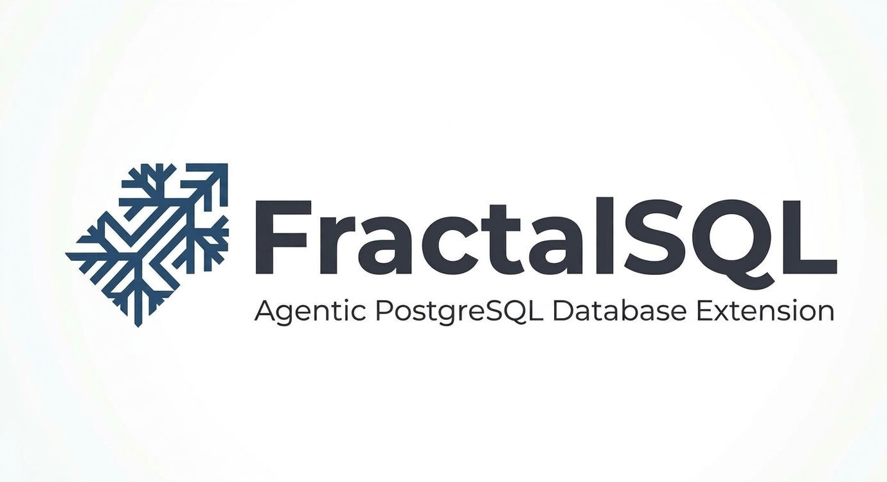

<p align="center">
  
</p>

# Sovereign Reasoning Setup Guide

The **Cognition Tier** is the intelligence layer of FractalSQL. It provides a pluggable bridge that lets PostgreSQL call Large Language Models (LLMs) and embedding providers directly from SQL.

By bringing reasoning directly into the PostgreSQL backend, FractalSQL lets you synthesize, analyze, and reason over your data without an external application-middleware hop. Sovereignty here is a deployment choice, not a guarantee baked into every provider: local models (Ollama/vLLM) keep data on your own infrastructure, while cloud providers (Bedrock, Azure OpenAI, Vertex) send it to that provider under your own account and compliance agreement.

---

## 🧠 The Cognition Model

At its core, the Cognition tier provides the `fractal_reason(query, context)` primitive. Unlike traditional RAG, which relies on external orchestrators, FractalSQL performs the synthesis inside the backend:

1. **Context Assembly**: You use ordinary SQL (subqueries, `jsonb_agg`, or `fractal_search_explore`) to gather the precise data needed.
2. **Sovereign Dispatch**: The extension dispatches the query and context to your configured LLM via a dedicated C-bridge.
3. **In-Place Synthesis**: The response is returned directly into your query result, allowing you to combine reasoning with standard SQL filters, joins, and aggregations in a single statement.

---

## 🛠️ Prerequisites

To activate the Cognition tier, you need a reasoning plugin and a configured endpoint.

### 1. The Reasoning Plugin
The reasoning plugin (`fractalsql-reasoning-http.so` or `.dll`) is installed into your PostgreSQL `pkglibdir`. Installing the file does not activate the feature; you must explicitly point the server to the plugin path in `postgresql.conf`.

**Find your `pkglibdir`**:
Run `pg_config --pkglibdir`. Common paths include:
- **Debian/Ubuntu (PGDG)**: `/usr/lib/postgresql/<major>/lib/`
- **RHEL/Rocky (PGDG)**: `/usr/pgsql-<major>/lib/`
- **Windows (EDB default)**: `C:\Program Files\PostgreSQL\<major>\lib\`

### 2. Technical Requirements
- **Extension Version**: `fractalsql-postgresql` 2.0.0+ (`SELECT fractal_version();`).
- **Plugin Version**: `fractalsql-reasoning-http` v1.2.1+ (required for Response Modes and System Tags).
- **Host Dependencies**: `libcurl` 7.75.0+ (required for AWS SigV4 auth).
- **Windows**: requires the Microsoft Visual C++ 2015-2022 Redistributable (x64) ([download](https://aka.ms/vs/17/release/vc_redist.x64.exe)).
- **Endpoint**: An LLM provider (Ollama, AWS Bedrock, Azure OpenAI, GCP Vertex, or any OpenAI-compatible API).

> **Shortcut**: for a local Ollama or a plain OpenAI-compatible endpoint,
> `scripts/easy_install.sh` (Linux/macOS) and
> `scripts/windows/easy_install.ps1` (Windows) do Steps 1–2 below for you
> interactively, activating the plugin and setting the GUCs in one pass.
> See **[docs/getting-started.md §5](getting-started.md#5-install-without-docker)**.
> The manual walkthrough below still applies for Bedrock/Azure/Vertex
> (the wizard only offers the two common defaults) and for anyone who
> wants to see exactly what gets configured.

---

## 🚀 Setup Sequence

## Step 1: Activate the Plugin
Add the following to `postgresql.conf` or a `conf.d/` file:

```ini
# Example for PG 17 on Debian/Ubuntu
fractalsql.reasoning_plugin = '/usr/lib/postgresql/17/lib/fractalsql-reasoning-http.so'
```
Then reload the configuration: `SELECT pg_reload_conf();`. The plugin loads lazily upon the first reasoning call in a session.

## Step 2: Universal LLM Connectivity
One of the core strengths of this design is **zero provider lock-in**: the provider bridge abstracts each provider's API, so your SQL calls to `fractal_reason()` remain identical whether you're using a local model for privacy or a cloud provider for scale.

Pick your provider and add the corresponding block to your configuration. Only one block should be active at a time.

## Ollama (Local or Private Network)
The gold standard for fully air-gapped, sovereign deployments. Traffic stays inside your network perimeter.

```ini
# Local Ollama
fractalsql.http_url             = 'http://127.0.0.1:11434/v1/chat/completions'
fractalsql.http_allow_plaintext = on
fractalsql.http_model           = 'gpt-oss:20b'
```
*Note: Run `ollama pull gpt-oss:20b` or `ollama pull gemma4:12b` or `ollama pull phi4:14b` before connecting.*

## Docker Model Runner (DMR)
On Docker Desktop, Docker Model Runner serves local models through an
OpenAI-compatible endpoint with no separate container to run. Enable
host access once (`docker desktop enable model-runner --tcp 12434`,
or Settings → Beta features in the Docker Desktop GUI):

```ini
# Docker Model Runner (host-side access)
fractalsql.http_url             = 'http://127.0.0.1:12434/engines/v1/chat/completions'
fractalsql.http_allow_plaintext = on
fractalsql.http_model           = 'ai/gpt-oss:20b'   # or 'ai/gemma4:12b' or 'ai/phi4'
```
*Note: Run `docker model pull ai/gpt-oss:20b` before connecting (or `ai/gemma4:12b` / `ai/phi4` for the alternatives); `docker model list` shows what's already pulled. `fractalsql.http_think`/`http_think_provider` work the same here as on any OpenAI-compatible URL. Requires Docker Desktop 4.41+ — Model Runner isn't available on a plain Docker Engine install without the Linux `docker-model-plugin` package, which serves the same `/engines/v1/` paths on port 12434. From inside *another container* on Docker Desktop — a containerized PostgreSQL, for example — use `http://model-runner.docker.internal/engines/v1/chat/completions` instead (no port, no host-TCP step needed); the repo's `docker-compose.dmr.yml` compose override does exactly that for the demo.*

## OpenAI-Compatible (OpenAI, Together AI, Fireworks, vLLM)
```ini
fractalsql.http_url   = 'https://api.openai.com/v1/chat/completions'
fractalsql.http_token = 'sk-...'
fractalsql.http_model = 'gpt-4o-mini'
```

## AWS Bedrock
Bedrock uses AWS SigV4 signing. The URL must point to the **OpenAI-compatible** surface.

```ini
# postgresql.conf (GUCs)
fractalsql.http_url   = 'https://bedrock-runtime.us-east-1.amazonaws.com/openai/v1/chat/completions'
fractalsql.http_model = 'amazon.nova-lite-v1:0'
```
**Critical**: Auth type and region are set via the reasoning plugin's own
lower-level environment variables, not the `fractalsql.*` GUCs:
```sh
export FSQL_REASONING_HTTP_AUTH_TYPE=aws-sigv4
export FSQL_REASONING_HTTP_AWS_REGION=us-east-1
```

Credentials come from the standard AWS environment of the process that loads the plugin: `AWS_ACCESS_KEY_ID` and `AWS_SECRET_ACCESS_KEY`, plus `AWS_SESSION_TOKEN` when you use temporary (IAM role) credentials. With `aws-sigv4` both the access key and the secret key are required. If either is missing, the plugin fails to initialize and prints `AUTH_TYPE=aws-sigv4 requires AWS_ACCESS_KEY_ID and AWS_SECRET_ACCESS_KEY` to stderr, so a missing credential shows up when the plugin loads rather than as a generic HTTP 403 from Bedrock. A credential or region that contains a control character (for example a stray newline pasted with a secret) is refused instead of being sent.

## Azure OpenAI
Azure requires a separate deployment for the chat model.

```ini
# postgresql.conf (GUCs)
fractalsql.http_url   = 'https://<resource>.openai.azure.com/openai/deployments/<deployment>/chat/completions?api-version=2024-02-01'
fractalsql.http_token = '<azure-api-key>'
fractalsql.http_model = 'gpt-4o'
```

## Google Vertex AI
Vertex AI exposes an OpenAI-compatible endpoint on the `openai/v1` path of your
project's region endpoint. Auth is a Google **service-account OAuth access
token** (a short-lived bearer), supplied via `http_token` exactly like an API
key. No SigV4-style signing is needed.

```ini
# postgresql.conf (GUCs)
fractalsql.http_url   = 'https://{LOCATION}-aiplatform.googleapis.com/v1/projects/{PROJECT}/locations/{LOCATION}/endpoints/openapi/chat/completions'
fractalsql.http_token = '<gcp-oauth-access-token>'
fractalsql.http_model = 'google/gemini-2.5-flash'
```

**Generating the token**: the `http_token` must be a valid Google OAuth access
token for a service account with the Vertex AI User role. The canonical way is
a service-account JSON key plus the gcloud CLI:

```sh
gcloud auth activate-service-account --key-file=sa-key.json
gcloud auth print-access-token    # paste the output into http_token
```

The token is short-lived (~1 hour). For a long-running install, refresh it on a
schedule (e.g. `pg_cron` or a sidecar that re-runs `print-access-token` and
`ALTER SYSTEM SET fractalsql.http_token = '...'`). The `fractalsql.http_token`
value is read on every reasoning call, so a reload (`pg_reload_conf()`) is not
strictly required after rotating it. But `ALTER SYSTEM` still needs a reload
to persist, and the env-var form (`FSQL_REASONING_HTTP_TOKEN`) is read once at
plugin load, so prefer the GUC form for rotating tokens.

---

## ⚖️ Hardware & Performance (Local Reasoning)

For users deploying Ollama locally, hardware affects "cold-load" latency.

| Resource | Recommendation | Notes |
| --- | --- | --- |
| **GPU VRAM** | 8GB $\rightarrow$ 16GB | 8GB runs Phi-4/Gemma4 (Q4); 16GB runs GPT-OSS 20B. |
| **System RAM** | 16GB+ | Covers model, OS, and PostgreSQL overhead. |
| **CPU** | AVX2 Support | Essential for acceptable CPU-side inference (Post-2016). |

### Handling Constrained Hardware
Local models can take up to 300s to cold-load into memory. To prevent `curl` from aborting the request, raise the timeout and low-speed windows in the **PostgreSQL process environment**:

```sh
export FSQL_REASONING_HTTP_TIMEOUT_MS=330000
export FSQL_REASONING_HTTP_LOW_SPEED_SECS=300
```
*Note: These are not GUCs. On Linux, add them to the cluster's `environment` file and restart the server.*

---

## 🛠️ Advanced Configuration

Every advanced knob at a glance -- details for each are in the sections below:

| Variable | Notes |
| --- | --- |
| `fractalsql.http_response_mode` | `text` (default) / `code` / `json` -- see [Response Modes](#response-modes) |
| `fractalsql.http_think` | Reasoning effort for hybrid-thinker models -- see [Reasoning Effort](#reasoning-effort) |
| `fractalsql.http_think_provider` | Request shape THINK uses -- see [Reasoning Effort](#reasoning-effort) |
| `fractalsql.http_native_url` | Override URL for the ollama/anthropic native shape |
| `fractalsql.http_num_ctx` | Ollama-native context-window cap |
| `FSQL_REASONING_HTTP_AUTH_TYPE` | `bearer` (default) / `api-key` / `aws-sigv4` -- see [AWS Bedrock](#aws-bedrock) |
| `FSQL_REASONING_HTTP_AWS_REGION` | AWS region for `aws-sigv4` |
| `FSQL_REASONING_HTTP_TIMEOUT_MS` | Total request timeout -- see [Handling Constrained Hardware](#handling-constrained-hardware) |
| `FSQL_REASONING_HTTP_LOW_SPEED_SECS` | Slow-response abort window |
| `FSQL_REASONING_HTTP_SYSTEM_PROMPT` | Replaces the baseline anti-injection system prompt -- see [Security & Governance](#-security--governance) |

### Response Modes
Shape how the plugin post-processes the LLM response:
- `text` (default): Raw content.
- `code`: Forces a single fenced code block and extracts it.
- `json`: Forces a fenced JSON block and validates structural integrity.

Applies to `fractal_reason`

Set the `fractalsql.http_response_mode` GUC (`ALTER SYSTEM SET
fractalsql.http_response_mode = 'json'; SELECT pg_reload_conf();`) like the
other `fractalsql.http_*` settings; a backend picks it up when it first calls
`fractal_reason`. When the GUC is unset, the `FSQL_REASONING_HTTP_RESPONSE_MODE`
value in PostgreSQL's service environment at start-up applies.

### Reasoning Effort
Hybrid-thinker models (Granite 4.2, OpenAI o-series, Claude extended thinking, DeepSeek-R1, QwQ) emit an internal reasoning trace before their final answer -- left uncontrolled, that trace dominates latency and, on memory-constrained GPUs, VRAM. Two GUCs throttle it:

| GUC | Values | Notes |
| --- | --- | --- |
| `fractalsql.http_think` | unset (default) / `none` / `off` / any other string (`low`, `medium`, `high`, `minimal`, `xhigh`, `max`, ...) | Unset (or `none`) sends no thinking-control field, so the model's own default applies. `off` explicitly disables thinking on the wire -- not the same thing, since a hybrid-thinker model's own default is often ON. Any other value is forwarded to the provider verbatim, not checked against a fixed list -- provider effort scales keep adding tiers, so this plugin doesn't hardcode any one vendor's current names. Applies to `fractal_reason()` and `fractal_text_to_sql()`'s GENERATE step only -- never `fractal_embed()`. |
| `fractalsql.http_think_provider` | unset (defaults to `openai`) / `openai` / `ollama` / `anthropic` / `vllm` / `grok` | Selects the request SHAPE, not a vendor -- `openai` also covers Azure OpenAI, AWS Bedrock, and Google Vertex AI's OpenAI-compatible surfaces, since this is independent of how `fractalsql.http_url` is authenticated. `grok` is for xAI's Grok models on Bedrock's OpenAI-compatible surface, which take a nested `reasoning.effort` field instead of `openai`'s top-level one. Ollama and Anthropic speak a native request shape instead, since their OpenAI-compatible endpoints don't honor thinking control. Ignored entirely when `http_think` is unset. |
| `fractalsql.http_native_url` | unset (default) / URL | Only consulted for the ollama/anthropic native shape. Leave unset to target `fractalsql.http_url` verbatim. |
| `fractalsql.http_num_ctx` | `0` (default, unset) / positive integer | Ollama-native context window cap (`options.num_ctx`) -- a measured fix for hybrid-thinker VRAM blowup on memory-constrained GPUs. Only applies when `http_think_provider=ollama`. |

```sql
-- Local Ollama, medium reasoning effort, capped context window
ALTER SYSTEM SET fractalsql.http_think = 'medium';
ALTER SYSTEM SET fractalsql.http_think_provider = 'ollama';
ALTER SYSTEM SET fractalsql.http_num_ctx = 16384;
SELECT pg_reload_conf();
```

The plugin never surfaces the reasoning trace itself -- `fractal_reason()`/`fractal_text_to_sql()` still return the final answer only, regardless of `http_think_provider`'s shape.

### Target-System Hints
Set `FSQL_REASONING_HTTP_SYSTEM_TAG=postgresql18` to hint to the model that it should use syntax appropriate for your specific PG version.

---

## 🧭 Setting names on every host

The same setting is spelled by the convention of the host it lives in: a SQL setting name where the extension runs inside the database, a `fractalsqld.conf` key where a daemon holds the model client. This table is the same in every host's guide; **—** means the host does not have the setting, and the note says why.

| Setting | SQLite, DuckDB (`fractal_config_set`) | PostgreSQL (`SET` / `ALTER SYSTEM`) | MariaDB (`fractal_config_set`, `fractalsqld.conf`) | Valkey (`fractalsqld.conf`, module argument) | Druid (`fractalsqld.conf`, property) | Plugin environment variable |
| --- | --- | --- | --- | --- | --- | --- |
| Reasoning plugin path | `reasoning_plugin` | `fractalsql.reasoning_plugin` | `reasoning_plugin` | `reasoning_plugin` | `reasoning_plugin` | `FRACTALSQL_REASONING_PLUGIN` |
| Chat endpoint URL | `http_url` | `fractalsql.http_url` | `reasoning_url` | `reasoning_url` | `reasoning_url` | `FSQL_REASONING_HTTP_URL` |
| Bearer token (a secret, never read back) | `http_token` | `fractalsql.http_token` | `reasoning_token` | `reasoning_token` | `reasoning_token` | `FSQL_REASONING_HTTP_TOKEN` |
| Chat model | `http_model` | `fractalsql.http_model` | `reasoning_model` | `reasoning_model` | `reasoning_model` | `FSQL_REASONING_HTTP_MODEL` |
| Allow plain HTTP | `http_allow_plaintext` | `fractalsql.http_allow_plaintext` | `reasoning_allow_plaintext` | `reasoning_allow_plaintext` | `reasoning_allow_plaintext` | `FSQL_REASONING_HTTP_ALLOW_PLAINTEXT` |
| Embedding endpoint URL | `http_embed_url` | `fractalsql.http_embed_url` | `embed_url` | `embed_url` | `embed_url` | set per call by the host |
| Embedding model | `http_embed_model` | `fractalsql.http_embed_model` | `embed_model` | `embed_model` | `embed_model` | set per call by the host |
| Reasoning effort | `http_think` | `fractalsql.http_think` | `think` | `think` | `think` | `FSQL_REASONING_HTTP_THINK` |
| Effort provider | `http_think_provider` | `fractalsql.http_think_provider` | `think_provider` | `think_provider` | `think_provider` | `FSQL_REASONING_HTTP_THINK_PROVIDER` |
| Native endpoint URL | `http_native_url` | `fractalsql.http_native_url` | `think_native_url` | `think_native_url` | `think_native_url` | `FSQL_REASONING_HTTP_NATIVE_URL` |
| Context window | `http_num_ctx` | `fractalsql.http_num_ctx` | `think_num_ctx` | `think_num_ctx` | `think_num_ctx` | `FSQL_REASONING_HTTP_NUM_CTX` |
| Response mode | `http_response_mode` (SQLite, DuckDB) | `fractalsql.http_response_mode` | environment of `fractalsqld` | environment of `fractalsqld` | environment of `fractalsqld` | `FSQL_REASONING_HTTP_RESPONSE_MODE` |
| Text-to-SQL attempts | `text_to_sql_max_attempts` (SQLite); DuckDB makes 3 | `fractalsql.text_to_sql_max_attempts` | `t2s_max_attempts` | — no text-to-SQL | `t2s_max_attempts` | — |
| Text-to-SQL statements allowed | `text_to_sql_allowed_statements` | `fractalsql.text_to_sql_allowed_statements` | `t2s_allowed_statements` | — no text-to-SQL | `t2s_allowed_statements` | `FRACTALSQL_TEXT_TO_SQL_ALLOWED_STATEMENTS` (DuckDB) |
| Text-to-SQL review pass | `text_to_sql_use_review` | `fractalsql.text_to_sql_use_review` | `t2s_use_review` | — no text-to-SQL | `t2s_use_review` | `FRACTALSQL_TEXT_TO_SQL_USE_REVIEW` (DuckDB) |
| Enterprise library | `enterprise_lib` | `fractalsql.enterprise_lib` | `enterprise_lib` | `enterprise_lib` | `enterprise_lib` | `FRACTALSQL_ENTERPRISE_LIB` |
| Ledger file | — the ledger is a table (SQLite) or held in memory (DuckDB) | — the ledger is a table | `enterprise_ledger_path` | `enterprise_ledger_path` | `enterprise_ledger_path` | `FRACTALSQL_ENTERPRISE_LEDGER_PATH` |
| Ledger authentication key (a secret) | `enterprise_ledger_key` (SQLite); — DuckDB holds the ledger in memory | `fractalsql.enterprise_ledger_key` | `enterprise_ledger_key` | `enterprise_ledger_key` | `enterprise_ledger_key` | `FRACTALSQL_ENTERPRISE_LEDGER_KEY` |
| Require the library's signature | `enterprise_require_signature` (DuckDB: can only be turned on) | `fractalsql.enterprise_require_signature` | `enterprise_require_signature` | `enterprise_require_signature` | `enterprise_require_signature` | `FRACTALSQL_ENTERPRISE_REQUIRE_SIGNATURE` |
| Ledger retention (`fade` or `exact`) | `ledger_retention` | `fractalsql.ledger_retention` | environment of `fractalsqld` | environment of `fractalsqld` | environment of `fractalsqld` | `FRACTALSQL_LEDGER_RETENTION` |
| Ledger size cap | `ledger_max_rows` (SQLite, rows; 0 = unbounded) or `ledger_max_bytes` (DuckDB, bytes; 0 = unbounded) | `fractalsql.ledger_max_rows` (rows) | environment of `fractalsqld`: `FRACTALSQL_LEDGER_MAX_BYTES` (bytes, default 1 GiB; 0 = unbounded) | environment of `fractalsqld`: `FRACTALSQL_LEDGER_MAX_BYTES` | environment of `fractalsqld`: `FRACTALSQL_LEDGER_MAX_BYTES` | `FRACTALSQL_LEDGER_MAX_BYTES` |
| Partial agent results | `agent_partial_reasoning_fail` (SQLite and DuckDB) | `fractalsql.agent_partial_reasoning_fail` | `fractal_agent_partial_fail(session, 'on')` | `agent-partial-reasoning-fail` | the request argument `partial` | — |
| Agents search through an index (`off`, `on`, `auto`) | `agent_use_index` | `fractalsql.agent_use_index` | `agent_use_index` | `agent-use-index` (`no`, `yes`, `auto`) | `druid.fractalsql.agent_use_index` | `FRACTALSQL_AGENT_USE_INDEX` (DuckDB) |
| Smallest table `auto` uses an index for (not used on MariaDB and Druid, where `auto` scans exactly until they calibrate an index) | `agent_index_min_rows` | `fractalsql.agent_index_min_rows` | `agent_index_min_rows` | `agent-index-min-rows` | `druid.fractalsql.agent_index_min_rows` | `FRACTALSQL_AGENT_INDEX_MIN_ROWS` (DuckDB) |
| Longest text cell an agent passes to the model | `agent_context_row_bytes` | `fractalsql.agent_context_row_bytes` | `agent_context_row_bytes` | — the total is capped at 1 MiB | `druid.fractalsql.agent_context_row_bytes` | `FRACTALSQL_AGENT_CONTEXT_ROW_BYTES` (DuckDB) |

Values that name an on/off choice accept `on`, `off`, `1`, `0`, `true`, `false`, `yes` and `no` everywhere they are a setting. `fractal_config_keys()` (where the host has it) lists the keys the running build knows.

---

## 🔒 Security & Governance

### The Sovereign Guardrail: Dedicated Roles
Never run reasoning queries as a superuser. Create a restricted role to bound what the LLM can see.

```sql
CREATE ROLE fsql_reasoning_role NOLOGIN;
GRANT CONNECT ON DATABASE mydb TO fsql_reasoning_role;
GRANT USAGE ON SCHEMA public TO fsql_reasoning_role;
GRANT SELECT (id, title, body) ON TABLE documents TO fsql_reasoning_role;
```

### Row-Level Security (RLS)
Enable RLS to ensure that the context subquery only returns rows the current session's user is permitted to see. This prevents "cross-tenant" data leakage to the LLM.

### Prompt Injection (OWASP LLM01)
The plugin prepends a baseline anti-injection instruction to every system message as a best-effort mitigation. No system-prompt instruction can fully prevent prompt injection from untrusted context, since the model still can't reliably distinguish instructions from data. Treat it as raising the bar, not closing the door. The real defense is architectural: RLS and column-level grants restricting what the context subquery can see (above), and treating every LLM response as untrusted output, never executed as SQL (see the checklist below). To replace the baseline instruction, set `FSQL_REASONING_HTTP_SYSTEM_PROMPT`.

---

## 📋 Production Checklist

- [ ] **Plugin Path**: `fractalsql.reasoning_plugin` is absolute and readable by the `postgres` user.
- [ ] **Auth Model**: A dedicated `fsql_reasoning_role` is used with column-level `SELECT` grants.
- [ ] **Isolation**: RLS is enabled on all tenant-sensitive tables.
- [ ] **Egress Review**: Cloud endpoints' DPA/BAA have been reviewed for the specific data classification.
- [ ] **Environment**: `FSQL_REASONING_HTTP_AUTH_TYPE` is correctly exported to the process environment (not just `postgresql.conf`).
- [ ] **Output Safety**: LLM responses are treated as untrusted display text and never executed as SQL.
