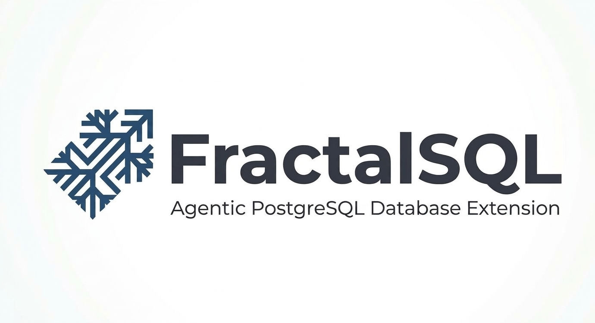

<p align="center">
  
</p>

# fractalsql-postgresql-mcp

The FractalSQL **MCP plugin for PostgreSQL**: a standalone C++17 binary that
exposes the extension's SQL surface to MCP clients (Model Context Protocol) —
one tool per SQL function, with every argument passed through libpq's
`$n`-placeholder binding (never string-built SQL), structured
`error_class`-tagged errors, and the engine's own row-locator (`ctid`) and
vector semantics carried through unmodified.

For the client-facing guide (configs for Claude Desktop, Cursor, Windsurf,
Claude Code and framework adapters such as LangChain, LlamaIndex and CrewAI,
worked examples, troubleshooting) see [`docs/mcp-plugin.md`](../docs/mcp-plugin.md).

## What it is

- `fractalsql-postgresql-mcp` — one binary, two transports: newline-delimited
  JSON-RPC over **stdio** (the desktop-client shape) by default, or
  **streamable HTTP** (`--http PORT` / `FSQL_MCP_TRANSPORT=http`) with
  Bearer-token auth and direct TLS (`--https` / `--tls-cert` / `--tls-key`).
- **82 tools** across seven categories (discovery 14, cognition 4,
  agency 22, analytics 23, enterprise 10, vectorizer 5, admin 4), each named
  after the SQL function it calls and whose `inputSchema` mirrors the
  function's documented signature 1:1.
- 5 resources (`fractalsql://schema|config|ledger/{kind}|vectorizer/status|agents`)
  and 11 task prompts (`incident_triage`, `portfolio_rebalance`, …).
- Postgres 14+, with **both** `CREATE EXTENSION fractalsql` and
  `CREATE EXTENSION fractalsql_agents` already installed — this server is a
  *caller*, never an installer: it runs zero DDL and never touches the
  enterprise GUCs.

## Build

Linux/macOS (pkg-config libpq + OpenSSL, g++/clang):

```sh
cd mcp
make
./fractalsql-postgresql-mcp --version
```

Windows (MSVC `cl /std:c++17 /EHsc`, linked against the PostgreSQL install's
`libpq.lib` and a vcpkg `x64-windows-static` OpenSSL — same dependency story
as the extension build itself): activate the VS dev env
(`scripts\windows\Import-VsDevEnv.ps1`) and either
`mcp\scripts\windows\build.bat`, or the `build_test.ps1` harness, which performs
the same compile+link and exercises the result end-to-end against a throwaway
cluster.

## Run

```sh
export PGHOST=localhost PGPORT=5432 PGUSER=app PGDATABASE=mydb
# libpq also honors PGPASSWORD/PGSERVICEFILE/.pgpass — or set FSQL_MCP_PG_CONN_URI
./fractalsql-postgresql-mcp                    # stdio, for an MCP client config
./fractalsql-postgresql-mcp --http 8765        # HTTP; set FSQL_MCP_AUTH_TOKEN
./fractalsql-postgresql-mcp --https 8765 --tls-cert cert.pem --tls-key key.pem
                                               # direct TLS (env form: FSQL_MCP_HTTPS +
                                               # FSQL_MCP_TLS_CERT_FILE/FSQL_MCP_TLS_KEY_FILE);
                                               # a missing/unparseable/mismatched pair is a
                                               # nonzero-exit config error, never a fallback
./fractalsql-postgresql-mcp --list-tools       # print the catalog (name, category), no connection
```

Transport note: the HTTP transport is **streamable HTTP** (POST to the MCP
path, JSON responses, `Mcp-Session-Id` per session). The MCP "HTTP + SSE"
transport of the 2024-11-05 protocol era is deliberately not implemented —
the 2025-03-26+ protocol revisions this server speaks (`initialize` echoes
`2024-11-05`/`2025-03-26`/`2025-06-18`) replaced SSE with streamable HTTP.
What the spec's per-SSE-session isolation requirement becomes here is
implemented unchanged: every `Mcp-Session-Id` gets its own dedicated
database connection for its lifetime, never shared while its session is
open.

## Authentication (HTTP transport)

stdio needs no credential — the client spawns the server as a trusted
subprocess. HTTP does: every JSON-RPC request carries an opaque bearer
token, and only `GET /healthz` and `GET /readyz` are exempt.

- **Deployment token** — `FSQL_MCP_AUTH_TOKEN`, or
  `FSQL_MCP_AUTH_TOKEN_FILE` (re-read whenever the file's mtime changes,
  so a secrets manager can rotate it without a restart; SIGHUP forces the
  reload). One secret for the whole deployment.
- **Per-client credentials** — `FSQL_MCP_TOKEN_POLICY_FILE` points at a
  JSON file of `{"tokens":[{"name","sha256","tools","expires"}]}`. The
  file holds the SHA-256 of each token, never the token itself; `tools` is
  `"*"` or a list of tool names, and `expires` is an optional ISO-8601
  date or date-time. A client that presents its own token *is* that
  client: its name is its fairness key and its allowlist bounds what it
  can call. A credential file that cannot be read or parsed at startup is
  a startup failure (exit 2); a malformed replacement at runtime keeps
  the last good policy.

Refusals: a missing or unknown token → `401` with
`WWW-Authenticate: Bearer realm="fractalsql-mcp"`; a token that was
presented but is wrong or expired → the same challenge plus
`error="invalid_token"`; a token in the query string → `401` (a query
string lands in proxy logs, so it is not a credential); an `Origin` not on
`FSQL_MCP_ALLOWED_ORIGINS` → `403`, checked before the token; a chunked
request body → `411`; a body over 32 MB → `413`; ambiguous framing → `400`.
Repeated failures are slowed down (capped at two seconds), the comparison
is constant-time, and no token is ever logged.

TLS and the token are independent controls: TLS protects the channel, the
token is the caller check. TLS 1.2 is the floor. A non-loopback bind
without TLS is refused at startup unless
`FSQL_MCP_ALLOW_PLAINTEXT_NONLOOPBACK=true`.

## Protocol versions

Both eras are served at once (`FSQL_MCP_PROTOCOL_ERA=dual`, the default):

- **Legacy** — the `initialize` handshake plus `Mcp-Session-Id`;
  revisions `2024-11-05`, `2025-03-26`, `2025-06-18`.
- **Modern** — stateless, one revision per request in
  `_meta.io.modelcontextprotocol/protocolVersion` and in the required
  `MCP-Protocol-Version` / `Mcp-Method` / `Mcp-Name` headers;
  revisions `2025-11-25`, `2026-07-28`. A missing or disagreeing header
  is `-32020` (HTTP 400), an unsupported revision is `-32022` (HTTP 400,
  with `data.supported` / `data.requested`), an unknown method is
  `-32601` (HTTP 404). `server/discover` returns every revision served.

`FSQL_MCP_PROTOCOL_ERA=modern` serves the modern era only and refuses the
legacy handshake outright.

## Session state

The modern era's `context_id` is an opaque 128-bit hex handle the server
mints for state-scoped tools and returns with the result. It is bound to
the credential that created it — another token is told the handle does not
exist, so a client can neither use nor probe for a handle it does not own.
`FSQL_MCP_SESSION_TTL_SECS` (default 3600) bounds how long an idle handle
survives and `FSQL_MCP_MAX_SESSIONS` (default 64) how many exist at once;
expired handles are dropped together with the database connections behind
them.

## Data at rest

The audit chain lives in the `fractalsql_ledger` table — one append-only,
hash-linked row per entry — with the chain head in `fractalsql_ledger_head`.
Because the chain is a table and not a file, there is no ledger file whose
mode has to be restricted: the chain's protection is the database's own
grants and the encryption of the volume the database lives on.

With a ledger key configured (`fractalsql.enterprise_ledger_key`), the
head record carries an HMAC-SHA256 over its own contents (chain kind and
row count), written in the same transaction as the count;
`fractal_ledger_verify()` fails when that MAC is missing, malformed or
wrong, and when the chain holds fewer rows than the head records.
`FSQL_LEDGER_ANCHOR_LOG=stderr|syslog` publishes the head to an off-host
log as one JSON line per append
(`{"event":"ledger_head","kind":K,"rows":N,"hash":"<hex>"}`), which makes
a truncation visible from outside the database.

Confidentiality at rest comes from the storage layer — community
PostgreSQL 14–18 has no built-in transparent data encryption, so the
ledger tables are covered by volume encryption (LUKS, cloud disk
encryption) plus whatever at-rest encryption a vendor distribution
provides. **The project does not encrypt the records inside the ledger.**
For sensitive deployments set `FSQL_AUDIT_REDACT=hash` (the SHA-256 hex
and byte length instead of the text) or `=truncate` (the first 64
characters) — redaction reaches the fields nested inside an entry as well,
and the values returned to the caller are never redacted.

Claude Desktop / Cursor / Windsurf / Claude Code style config (any MCP client that takes an `mcpServers` block):

```json
{ "mcpServers": { "fractalsql": {
    "command": "/path/to/mcp/fractalsql-postgresql-mcp",
    "env": { "PGHOST": "localhost", "PGDATABASE": "mydb", "PGUSER": "app" } } } }
```

## Least privilege

The server enforces nothing beyond whatever role its connection opened as.
Create a dedicated role instead of pointing it at a superuser:

```sql
CREATE ROLE fractalsql_mcp LOGIN PASSWORD '...';
GRANT USAGE ON SCHEMA public TO fractalsql_mcp;
GRANT SELECT, INSERT, UPDATE ON my_tables TO fractalsql_mcp;   -- scope tightly
-- cross-tenant isolation is RLS' job: enable row security on tenant tables
```

## Safety posture

- Every argument reaches SQL as a `$n` bound parameter with an explicit cast.
  The single documented exception is the admin tool's `ALTER SYSTEM SET
  fractalsql.<guc>` (utility statements reject `$n`): the GUC name comes from
  a fixed allowlist and the value is quote-doubled — never interpolated input.
- Structured errors (`error_class`: schema / engine / connectivity / server /
  cancelled); `server` class never leaks internals; engine errors surface
  verbatim. No retries are ever performed by the transport.
- Concurrency caps (cheap 50 / expensive 5 / per-client 2 — env-overridable),
  row ceilings (default 100, hard cap 1000), read-only kill switch
  (`FSQL_MCP_READ_ONLY=true` refuses every tool the safety-annotation lock
  marks destructive — every tool the lock marks destructive, not every write; the
  real no-write boundary is the connection's role + RLS), `$ /cancel`
  → `PQcancel` with late-result discard.
- Untrusted tool output (reasoning answers, agent rows) is passed to clients
  labeled as DATA, never auto-executed; `auto_execute` defaults off everywhere.
- Supply chain: one vendored third-party header (`vendor/json.hpp`,
  nlohmann v3.11.3 pinned); the committed `.mcp-schema-lock` (SHA-256 over
  the canonical tool projection), `.mcp-safety-annotations-lock` (human-
  diffable per-tool safety hints — mismatches hard-fail startup), and
  `manifest.json` are all regenerated with `--write-schema-lock`,
  `--write-safety-annotations-lock`, `--write-manifest`.
  The server reads the two locks from **its own directory** (the directory
  the executable lives in — `FSQL_MCP_LOCK_DIR`, `FSQL_MCP_SCHEMA_LOCK` and
  `FSQL_MCP_SAFETY_LOCK` override the location), so every package ships them
  next to the binary: `/usr/lib/postgresql/<ver>/lib/` (deb),
  `/usr/pgsql-<ver>/lib/` (rpm), `mcp/` (macOS tarball, Windows MSI); a
  packaged install falls back to the package's own doc directory. A missing
  lock is reported and **refuses startup** (exit 2 for the schema lock,
  exit 3 for the safety-annotation lock) unless
  `FSQL_MCP_ALLOW_MISSING_LOCKS=true` — or an explicit
  `FSQL_MCP_REQUIRE_LOCKS=false` — says the drift check may be skipped.

## Development

```sh
make && ./fractalsql-postgresql-mcp --write-schema-lock      # after tool-table edits
./build_test.sh -G 33      # full gate: rebuild + stdio smoke vs a throwaway cluster
python3 test/smoke.py      # standalone assert suite (FSQL_MCP_EXE=/path/to/binary)
```

## Hardening switches

| Variable | Effect |
|---|---|
| `FSQL_MCP_READ_ONLY` | `true` / `1` / `on` / `yes` (any case). Refuses every tool that writes state, and applies the engine-side backstop where the engine has one. |
| `FSQL_MCP_ALLOW_MISSING_LOCKS` | Off by default. A missing schema or safety-annotation lock file stops startup; set `true` to run without the drift check (development only). An explicit `FSQL_MCP_REQUIRE_LOCKS=false` has the same effect. Lock files are looked up beside the executable, then in the package's own doc directory. |
| `FSQL_MCP_ALLOW_PLAINTEXT_NONLOOPBACK` | Off by default. The HTTP transport refuses to bind a non-loopback address without TLS (enable TLS with `FSQL_MCP_HTTPS=true` and a certificate/key); set this to `true` to accept a plaintext bind on a network you control. |
| `FSQL_MCP_ALLOWED_ORIGINS` | Unset by default. The browser origins this deployment accepts; the loopback origins are always allowed, a request with no `Origin` header is allowed through, and any other origin is refused with `403` before the token is checked. |
| `FSQL_MCP_TOKEN_POLICY_FILE` | Unset by default. A per-client credential file (`{"tokens":[{"name","sha256","tools","expires"}]}`); the server hashes the presented token and compares it in constant time. |
| `FSQL_MCP_PROTOCOL_ERA` | `dual` (default) serves the legacy and the modern protocol eras; `modern` serves the modern era only and refuses the legacy handshake. |
| `FSQL_MCP_ALLOW_AUTO_EXECUTE` | Off by default. Whether a model may ask for `auto_execute: true` on the two tools that take it — the operator decides, not the model. |
| `FSQL_MCP_CONFIG_WRITES` | `safe` (default) allows only the model names and the think mode; `off` refuses every config write; `all` allows any known key. An unrecognized value is treated as `safe`. |
| `FSQL_MCP_SESSION_TTL_SECS` | 3600 by default. How long an idle session or context handle survives. |
| `FSQL_MCP_MAX_SESSIONS` | 64 by default. How many sessions and context handles exist at once. |

Every state-changing tool is reported with `destructiveHint: true`, so a client that honours the annotation asks before calling it and read-only mode refuses it. Each `tool_call` log line carries a short `client` digest identifying the session or token that made the call.

Engine-side (read by the PostgreSQL backend, not by this server):
`FSQL_AUDIT_REDACT` (`none` / `hash` / `truncate`) decides what the audit
chain keeps of the question, the generated SQL, the analysis and the result
rows; `FSQL_LEDGER_ANCHOR_LOG` (`stderr` / `syslog`) publishes the chain
head off-host on every append; `FSQL_REASONING_REQUIRE_SIGNATURE=0` turns off the reasoning plugin's
signature requirement. See [`docs/mcp-plugin.md`](../docs/mcp-plugin.md) →
"Data at rest" for the whole story.
